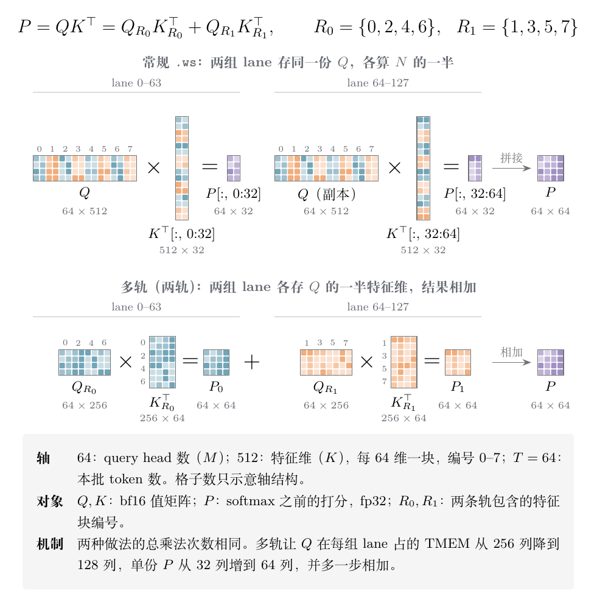

> 前置阅读：[Blackwell TMEM 与 tcgen05 MMA 深度解析](https://xuesongtap.github.io/2026/05/19/blackwell-tmem-tcgen05-mma.html)
>
> 资料核对于 2026-11-05，对应 PTX ISA 9.5 和 FlashMLA 提交 `395cb3a`

读 FlashMLA 的 SM100 代码时，可以看到一种非标准的 `tcgen05.mma.ws` 用法，代码里称为多轨矩乘（multi-rail GEMM，`MRGEMM`），目前固定为两轨。下文沿用这个叫法。

按 PTX 和 CUTLASS 的常规写法，`.ws` 在 M=64 时，A 要在 TMEM 的两组 lane 里各存一份相同的副本。

FlashMLA 没有照这个写法来：它往两组 lane 写入的不是两份相同的 Q，而是 Q 的不同特征维。于是一条 MMA 同时算出两份部分结果 P0 和 P1，相加后才是完整的 QK

这种做法省的是 TMEM 空间和指令数，乘法次数不变。在 64-head、512 维的解码配置中，Q 占用的 TMEM 从 256 列降到 128 列，P 才放得下


## 1. `.ws` 的原始设计

### 1.1 指令与形状

PTX 把 `tcgen05.mma.ws` 描述为“weight stationary convolution matrix multiply”，本意是服务卷积：A 放权重，B 放激活，collector 缓存作用在 B 上。[10] 它只支持 `cta_group::1`，M 可以取 32、64、128，N 只能取 64、128、256（f16 dense）。[11] 与普通模式相比，它多了 M=32，N 的选择却少了很多，面向的是“M 小、N 大且规整”的情况。

### 1.2 M=64 的 2×2 datapath

PTX 的布局表规定，`.ws` 模式下 M=64 使用 2×2 datapath（Layout E），而非 `.ws` 的 M=64 使用 4×1，只利用一半 datapath。[1] 

2×2 的含义是：128 条 lane 分成两组，每组 64 条，分别负责 B 的前后两半 N。

```text
lane 0-63   : A × B[N 的前一半] → D[:, 0:N/2]
lane 64-127 : A × B[N 的后一半] → D[:, N/2:N]
```

两组 lane 都要读到完整的 A，所以 A 在 TMEM 里存两份。

### 1.3 为什么 A 要复制

为什么不能让 lane 64–127 直接读 lane 0–63 上的 A？原因有两层：

- **TMEM 按 lane 分片。** PTX 规定 TMEM 分成 4 块，warpgroup 中的 warp i 只能用 `tcgen05.ld/st` 访问 lane 32i 到 32i+31。[11] FlashMLA 的注释也说明，`.ws` 下 lane 组 g 从自己的 lane 读取 A。[6] 也就是说，每组 datapath 只能看到本组 lane 上的 A。B 在共享内存中，所有 datapath 都能读到，所以不需要复制。
- **指令要保持通用 GEMM 的语义。** 调用者给出任意 A、B，就应该得到完整的 $D=A\times B$。在 N 方向分工时，每组 lane 算的是同样的 64 行，自然需要同样的 A。如果改成按 K 切，两组得到的只是部分和，硬件又不会在组间相加，D 就不再是 $A\times B$。

所以副本可以看作“满 datapath + A 在 TMEM 本地读取 + 通用 GEMM 语义”三者同时成立的代价。官方另外也有两条不复制的路：A 从共享内存读（`a-desc` 形式），或者不用 `.ws`、接受 M=64 只用一半 datapath（Layout F）。[1]

### 1.4 CUTLASS 中的副本布局

CUTLASS 的 `tmem_e_frg_ws` 在 M=64 分支多出一个 `_2` 维，步长为 `_64`，表达的就是这份副本；M=32 分支对应 `_4` 和 `_32`。[2]

```cpp
// tmem_e_frg_ws，TF32 分支，M_MMA == 64
Layout<Shape <Shape <_8,   _2, _4>, Shape <  _8,_2>, _2>,
       Stride<Stride<_1,_1024,_16>, Stride<_128,_8>,_64>>{};
```

### 1.5 副本占用的 TMEM

副本的代价是 TMEM 容量。每个 SM 的 TMEM 按 128 lane × 512 列 × 32 bit 计算，共 256 KB。

以 FlashMLA 的decode配置为例（64 head、D=512、bf16，每列放 2 个元素），一组 lane 存完整的 Q 就要 256 列。输出 O 也占 256 列，[3] 

两者已经占满 512 列，P 没有位置

## 2. FlashMLA 的多轨矩乘

### 2.1 把 Q 按特征维拆成两轨

QK 要计算的是：

$$
P = Q K^{\top},\qquad Q\in\mathbb{R}^{64\times 512},\quad K\in\mathbb{R}^{T\times 512}
$$

矩阵乘法可以沿特征维分块。把 512 维分成互不相交的两组 $R_0$、$R_1$，结果不变：

$$
P = Q_{R_0}K_{R_0}^{\top} + Q_{R_1}K_{R_1}^{\top}
$$

FlashMLA 把这两项放到两组 lane 上，代码里称为两条“轨”。按 64 维一块，8 块交替分配：[4]

```text
逻辑视图：   |0|1|2|3|4|5|6|7|
多轨视图：
  轨 0：     |0|2|4|6|
  轨 1：     |1|3|5|7|
```

### 2.2 A 和 B 怎样配合

A 不再是两份相同的副本，每组 lane 只存本轨的 256 维。B 也要配合：同一批 KV 被重新解释成 $2T$ 行、$D/2$ 维，N 的前后两半分别对应两条轨。[5] 

于是 MMA 的形状变成 M=64、N=2T、K=256：

下图对比两种做法（T=64）。图中各轴用统一比例，色块编号对应上面的 8 个特征块：



硬件的计算方式没有变化：每组 lane 仍然用本组的 A 乘 B 的对应一半。变化在于软件没有往两组 lane 写入相同的数据。

FlashMLA 的注释这样描述 `.ws` 的行为：lane 组 g 从自己的 lane 读取 A，并把 D 的第 g 个 N 切片写回这些 lane。[6]

### 2.3 P0 与 P1 的归约

P0、P1 读回寄存器后，通过共享内存相加。`retrieve_mask_and_reduce_p` 先做 mask，再做 reduce，原因是 `-inf` 与 NaN、`+inf` 以外的值相加仍为 `-inf`，被屏蔽的 token 不会出错。[7]

### 2.4 与官方用法的区别

把硬件的行为写成公式，两种用法的差别就很清楚。M=64 的 `.ws` 中，lane 组 g（g=0,1）做的事情是：

$$
D_g = A_g \times B_g
$$

其中 $A_g$ 是存在第 g 组 lane 上的 A，$B_g$ 是 B 的第 g 份列，$D_g$ 写回第 g 组 lane。硬件不检查 $A_0$ 与 $A_1$ 是否相同，两种用法只是往这个公式里填了不同的数据：

| | 官方用法：按 token 切 | FlashMLA：按特征维切 |
| --- | --- | --- |
| $A_0$ / $A_1$ | 同一份完整的 Q（512 维） | $Q_{R_0}$ / $Q_{R_1}$（各 256 维） |
| $B_0$ / $B_1$ | 前一半 / 后一半 token 的 K，512 维 | 全部 token 的 K，分别只取 $R_0$ / $R_1$ 维 |
| 指令形状 | M=64，N=T，K=512 | M=64，N=2T，K=256 |
| $D_0$ / $D_1$ | 前一半 / 后一半 token 的分数 | 全部 token 的部分和 $P_0$ / $P_1$ |
| 得到 P | 拼接 $[D_0 \mid D_1]$ | 相加 $D_0 + D_1$ |

### 2.5 一个数值例子

用一个小例子走一遍：1 个 head，特征维 4，2 个 token。为了方便，这里按连续两半切特征维，真实代码按 64 维一块交替分配。

```text
q  = [1, 2, 3, 4]
k1 = [5, 6, 7, 8]      q·k1 = 70
k2 = [1, 1, 1, 1]      q·k2 = 10

官方用法：
  lane 组 0：A0 = [1,2,3,4]   B0 = k1              → D0 = 70
  lane 组 1：A1 = [1,2,3,4]   B1 = k2              → D1 = 10
  拼接得 P = [70, 10]，A 共存 8 个数

FlashMLA：
  lane 组 0：A0 = [1,2]   B0 = [k1[0:2], k2[0:2]]  → D0 = [17, 3]
  lane 组 1：A1 = [3,4]   B1 = [k1[2:4], k2[2:4]]  → D1 = [53, 7]
  相加得 P = [70, 10]，A 共存 4 个数
```

这里 A 和 B 必须一起改。只把 Q 按轨分开而 B 不重排，lane 组 1 算出的会是 $Q_{R_1}K_{R_0}^{\top}$ 这样的交叉项，结果是错的。FlashMLA 没有多拷贝 KV，而是用共享内存描述符把同一块 KV 重新解释成按轨排列的 B。[5]

总结起来，官方用法用一份 A 的副本换来了通用的 GEMM 语义；FlashMLA 放弃了这份通用性，用一次 P0 + P1 的加法换回了副本占用的 TMEM。

## 3. 账怎么算

### 3.1 资源对照

以 T=64、D=512 的 64-head 配置为例，下表“常规”一列是假设不用多轨时的推算值：

| 项目 | 常规 `.ws` | 多轨（两轨） |
| --- | --- | --- |
| MMA 形状 | 64×64×512 | 64×128×256 |
| 指令数（K=16 一条） | 32 条 | 16 条 |
| 每条指令的乘法次数 | 65,536 | 131,072 |
| 总乘法次数 | 2,097,152 | 2,097,152 |
| Q 占 TMEM（每组 lane） | 256 列 | 128 列 |
| 单份 P 占 TMEM（每组 lane） | 32 列 | 64 列 |
| P 的后处理 | 读回即可用 | 需要 P0 + P1 |

### 3.2 三点结论

可以看到三点：

- **乘法次数不变。** 这项技巧不会增加算力，收益来自 TMEM 和调度。
- **P 变大了。** Q 省下 128 列，单份 P 多占 32 列，净省 96 列。解码配置的实际布局是 O 占 0–256 列、Q 从第 256 列开始占 128 列、P 从第 400 列开始占 64 列。[3]
- **多了一步 reduce。** 这部分计算落在 softmax 所在的 warpgroup，并依赖共享内存交换。

单条指令的 N 变大后，单次发射覆盖的工作量翻倍

## 4. FlashMLA 中的实现

### 4.1 关键组件

这些配置和原子可以直接在代码中找到：

| 组件 | 取值或做法 | 位置 |
| --- | --- | --- |
| QK 原子 | `SM100_MMA_F16BF16_WS_TS_NOELECT`，M=64，N=`B_TOPK*2` | [5][9] |
| PTX 指令 | `tcgen05.mma.ws.cta_group::1.kind::f16` | [9] |
| SV 原子 | `SM100_MMA_F16BF16_WS_SS_NOELECT`，M=64，N=256 | [5] |
| 轨道数 | `NUM_MRGEMM_RAILS = 2`，注释写明目前必须为 2 | [6] |
| TMEM 布局 | `tmem_frg_elastic`，用 `FOLD_DEGREE` 指定折叠度 | [9] |

### 4.2 QK 的配置

QK 的关键配置如下：

```cpp
static constexpr int B_TOPK = 64;
static constexpr int QK_MRGEMM_N = (128/64)*B_TOPK;   // 128
static constexpr int QK_MRGEMM_K = D_V / (128/64);    // 256

using TiledMMA_P = decltype(make_tiled_mma(
    SM100_MMA_F16BF16_WS_TS_NOELECT<bf16, bf16, float, MMA_M, QK_MRGEMM_N,
                                    UMMA::Major::K, UMMA::Major::K>{}
));
```

FlashMLA 自己补了原子，因为作者在注释里说明 CuTe 的 UTCMMA 不支持 `.ws`。`tmem_frg_elastic` 的注释也说明了 `FOLD_DEGREE` 的含义：官方用法中 A 在不同行之间复制，取 1；多轨矩乘时取轨道数。[9]

### 4.3 SV 与 128-head 配置

只有 QK 走多轨。SV 用的是 `_SS` 原子，A（即 S）在共享内存中，不存在 TMEM 副本可以替换。[5]

128-head 的配置同样使用多轨，但走的是 2-CTA 的 `2x1SM_TS` 原子，B_TOPK 为 96。[6] PTX 的布局表显示 `cta_group::2` 的 M=128 dense 模式同样是 2×2 datapath，[1] 所以这个思路并不只适用于 `.ws`。

## 参考

[1] NVIDIA, PTX ISA 9.5, §9.7.18.10.5 Data Path Layout Organization, §9.7.18.10.5.5 Layout E. <https://docs.nvidia.com/cuda/parallel-thread-execution/index.html>

[2] NVIDIA CUTLASS, `tmem_e_frg_ws`, `include/cute/atom/mma_traits_sm100_frag.hpp`. <https://github.com/NVIDIA/cutlass/blob/main/include/cute/atom/mma_traits_sm100_frag.hpp>

[3] DeepSeek FlashMLA, 解码配置中的 `tmem_cols`, `decode/sparse/head64/config.h`. <https://github.com/deepseek-ai/FlashMLA/blob/395cb3afbb331fef7b1b21e9340861b9436b42d8/csrc/cuda_kernels/sm100/decode/sparse/head64/config.h#L78-L85>

[4] DeepSeek FlashMLA, 多轨视图注释, `decode/sparse/head64/kernel.cuh`. <https://github.com/deepseek-ai/FlashMLA/blob/395cb3afbb331fef7b1b21e9340861b9436b42d8/csrc/cuda_kernels/sm100/decode/sparse/head64/kernel.cuh#L473-L481>

[5] DeepSeek FlashMLA, K 的重排与 MMA 原子, `prefill/sparse/fwd/head64/config.h`. <https://github.com/deepseek-ai/FlashMLA/blob/395cb3afbb331fef7b1b21e9340861b9436b42d8/csrc/cuda_kernels/sm100/prefill/sparse/fwd/head64/config.h#L88-L131>

[6] DeepSeek FlashMLA, 多轨矩乘说明, `fused_norm_rope_attn_rope_cast_fwd/core_attn/config.h`. <https://github.com/deepseek-ai/FlashMLA/blob/395cb3afbb331fef7b1b21e9340861b9436b42d8/csrc/cuda_kernels/sm100/prefill/sparse/fused_norm_rope_attn_rope_cast_fwd/core_attn/config.h#L204-L210>

[7] DeepSeek FlashMLA, `retrieve_mask_and_reduce_p`, `common_subroutine.h`. <https://github.com/deepseek-ai/FlashMLA/blob/395cb3afbb331fef7b1b21e9340861b9436b42d8/csrc/cuda_kernels/sm100/common_subroutine.h#L47-L105>

[8] DeepSeek FlashMLA, README. <https://github.com/deepseek-ai/FlashMLA/blob/395cb3afbb331fef7b1b21e9340861b9436b42d8/README.md>

[9] DeepSeek FlashMLA, `tmem_frg_elastic` 与 `.ws` 原子, `kerutils/device/cuda/sm100/gemm.cuh`. <https://github.com/deepseek-ai/FlashMLA/blob/395cb3afbb331fef7b1b21e9340861b9436b42d8/csrc/3rdparty/kerutils/include/kerutils/device/cuda/sm100/gemm.cuh>

[10] NVIDIA, PTX ISA 9.5, §9.7.18.10.10.3 `tcgen05.mma.ws`. <https://docs.nvidia.com/cuda/parallel-thread-execution/index.html>

[11] NVIDIA, PTX ISA 9.5, §9.7.18.2.1 Matrix Shape（Table 48）, §9.7.18.8.1 Access restrictions. <https://docs.nvidia.com/cuda/parallel-thread-execution/index.html>
