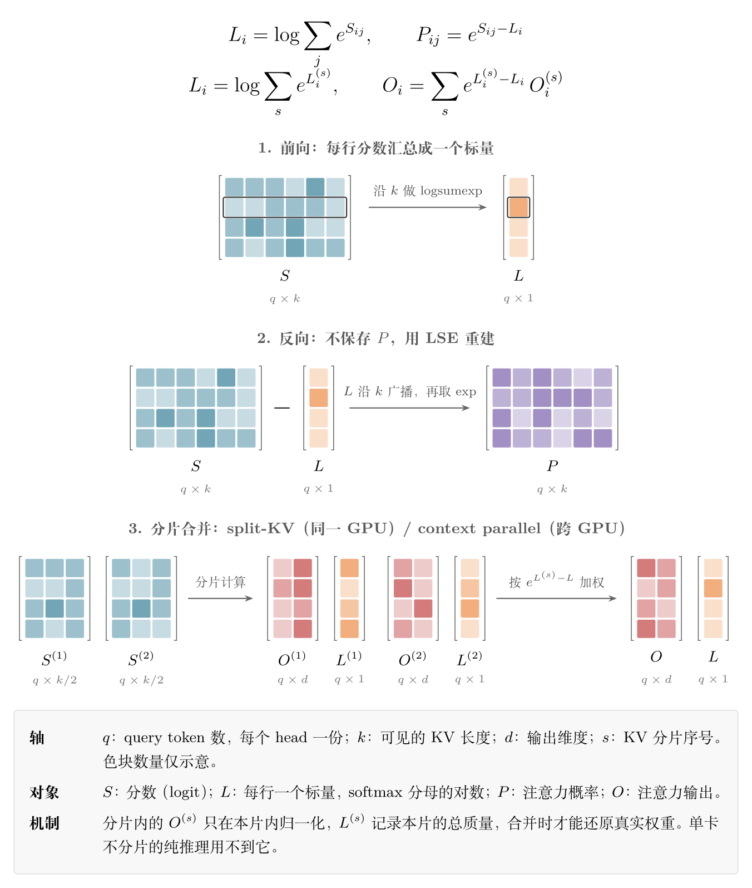

> 前置阅读：[FlashAttention：IO 感知的精确 Attention 计算](https://xuesongtap.github.io/2026/03/22/flash-attention.html)
>
> 资料核对于 2026-11-09，对应 flash-attention 提交 `478b5b0`、FlashMLA 提交 `395cb3a`、FlashInfer 提交 `0232a8b`

一行 query 如果看不到任何 key，它的 log-sum-exp（LSE）应该是多少？

按定义是 $\log 0=-\infty$。FlashAttention-2 给出的却是 $+\infty$，FlashMLA 的接口也是如此，两种值并存让下游代码多了不少判断。Hopper 路径在 2025 年的一次重构里改回了 $-\infty$，但旧路径和一些分支至今还保留着 $+\infty$。


## 0. LSE 是什么，什么阶段需要它

对第 $i$ 行 query，记分数为 $S_{ij}$（已含 softmax scale，被遮挡的位置为 $-\infty$）：

$$
Z_i=\sum_j e^{S_{ij}},\qquad
L_i=\log Z_i,\qquad
P_{ij}=e^{S_{ij}-L_i},\qquad
O_i=\sum_j P_{ij}V_j
$$

$L_i$ 就是 LSE：每个 head 的每行 query 一个标量，表示 softmax 分母的对数。算完 $O$ 之后，如果没有人再需要这一行的分母，LSE 就可以丢掉。所以问题变成：哪些阶段在 $O$ 算完之后还要用到分母？



| 阶段 | 是否需要 LSE | 用途 |
| --- | --- | --- |
| 单卡、KV 不切分的纯推理 | 不需要 | 前向算完 $O$ 就结束，`return_lse` 默认关闭[24]，`flash_attn_with_kvcache` 也要显式传 `return_softmax_lse=True` 才返回[22] |
| 训练的反向传播 | 需要，前向保存到反向 | 重建概率 $P$[2][25] |
| split-KV（`num_splits > 1`） | kernel 内部需要 | 合并同一 GPU 上各分片的输出[26] |
| context parallel | 需要，跨 rank 传输 | 合并不同 GPU 上各分片的输出[27] |
| attention sink | 需要 | FlashMLA 把输出再乘 $e^{L}/(e^{L}+e^{\text{sink}})$[4] |

### 0.1 反向：不存注意力矩阵

$P$ 的形状是 $q\times k$，长序列下保存它的内存开销很大。FlashAttention 的做法是前向只保存 $L$（$q\times 1$），反向时重新计算 $S$，再用 $P_{ij}=e^{S_{ij}-L_i}$ 得到概率。[1][2] 在接口层面，`softmax_lse` 和 `q, k, v, out` 一起通过 `save_for_backward` 存下来，交给反向 kernel。[25]

### 0.2 分片合并：还原各分片的真实权重

KV 被切成多个分片时，每个分片只能看到自己的 key，输出已经按本片的分母归一化：

$$
O_i^{(s)}=\frac{\sum_{j\in s}e^{S_{ij}}V_j}{Z_i^{(s)}}
$$

全局结果要把分母换回总和：

$$
O_i=\frac{\sum_s Z_i^{(s)}O_i^{(s)}}{\sum_s Z_i^{(s)}}
=\sum_s e^{L_i^{(s)}-L_i}\,O_i^{(s)},
\qquad
L_i=\log\sum_s e^{L_i^{(s)}}
$$

所以只传 $O^{(s)}$ 不够，还要传 $L^{(s)}$。比如两个分片的 LSE 分别是 1 和 0，正确权重约为 0.731 和 0.269，直接取平均得到的 0.5 和 0.5 是错的。传对数而不是 $Z$ 本身，是因为 $e^{S}$ 在分数较大时容易超出浮点范围。

两种分片场景的公式相同，区别只在分片的位置：

- **split-KV**：解码时 Q 很短，把 KV 切开可以让更多 SM 并行工作。[2] 分片结果由 combine kernel 合并，即使调用方不要 LSE，kernel 内部也要算。
- **context parallel**：KV 分布在不同 GPU 上，每个 rank 算出部分输出和部分 LSE，通信后再合并。[27] 通信和张量布局见 [Sequence Parallel 与 Context Parallel](https://xuesongtap.github.io/2026/03/22/sequence-context-parallel.html)。

注意这几个阶段对 LSE 的用法并不一样：合并时要把它**累加**，重建概率时要把它当**分母**。后面空行的问题，就出在这两种用法上。


## 1. 现象：同一个问题，不同的答案

causal 或滑动窗口遮挡、key padding、KV 长度为 0、稀疏注意力的 top-k 为空，都会产生没有可见 key 的“空行”。此时 $Z_i=0$，输出应该全为 0，这一点各实现是一致的。


不一致的是 LSE：

| 实现 | 分片内部 | 全遮挡行的最终输出 | `seqlen_k == 0` |
| --- | --- | --- | --- |
| FA-2（`csrc/`） | `-inf` | **`+inf`** | `+inf` |
| FlashMLA 解码 | `-inf` | **`+inf`** | 未单独核对 |
| FA-3（`hopper/`） | `-inf` | `-inf` | **`+inf`** |
| FA-4（CuTe，`flash_attn/cute`） | `-inf` | `-inf`（有 learnable sink 时为 sink 值）[23] | `-inf`（同左） |

FA-2 的 $+\infty$ 来自这一行：[3]

```cpp
lse(mi) = (sum == 0.f || sum != sum)
    ? (Split ? -INFINITY : INFINITY)
    : row_max(mi) * softmax_scale + __logf(sum);
```

FlashMLA 则把它写进了接口文档：[4]

```text
If a q token does not attend to any k token, then max_logits is -inf, lse is +inf, out is all zeros.
```

而 CuTe 的测试断言的是相反的值：[5]

```python
assert torch.count_nonzero(o) == 0
assert torch.isneginf(lse).all()
```

两种值混用时，会悄悄算错。把最终输出的 $+\infty$ 当作分片 LSE 再合并，`max` 会变成 $+\infty$，结果是：

```text
输入 LSE:        [1.0, +inf]
合并后 LSE:      +inf
各分片的权重:    [0.0, NaN]
```

正常分片的权重变成 0，空分片的权重变成 NaN。这只在空行上发生，正常数据测不出来。


## 2. 代价：到处都要加判断

下面只列读源码时实际看到的位置，不是完整统计。

### 2.1 在两种约定之间转换

| 位置 | 判断 |
| --- | --- |
| FA-2 softmax | `Split ? -INFINITY : INFINITY`，kernel 要知道结果之后是否还会合并[3] |
| FA-2 combine | 输入按 `-inf` 算，全空时再改写成 `INFINITY`[6] |
| FA-2 测试（CUDA 和 AMD 两份） | 参考实现里 `lse[lse == -inf] = inf`[7] |
| FlashMLA combine | `global_lse != INFINITY` 分支，以及 `attn_sink == -INFINITY ? +INFINITY : ...`[8] |
| FlashMLA 测试 | `ref.py` 两处，另有两个测试文件各转一次[9] |
| Hopper 空 KV 分支 | 常规路径是 `-inf`，这里填 `+inf`[10] |

FlashMLA 的 `attn_sink` 分支最能说明问题，注释里的前提条件就写了一半：

```cpp
if (global_lse != INFINITY) {
    // If attn_sink is +inf, global_lse will be +inf and scale factors will be exp2f(local_lse - inf) = 0 (since local_lse never becomes +inf)
    // If attn_sink is -inf, this has no effect on global_lse
    global_lse += log2f(1 + exp2f(attn_sink*CUDART_L2E_F - global_lse));
} else {
    // We have no tokens to attend, so global lse should be attn_sink*CUDART_L2E_F (+inf if it's -inf or +inf)
    global_lse = attn_sink == -INFINITY ? +INFINITY : attn_sink*CUDART_L2E_F;
}
```

### 2.2 下游框架的防御代码

FlashInfer 的跨卡 LSE 合并专门加了一层清洗，注释直接点明了原因：[11]

```cpp
// Sanitise an incoming LSE. A shard that contributed nothing reports -inf; some
// backends emit NaN or +inf instead, and both must fold to "no weight" rather
// than poisoning the whole merge.
__device__ static inline float sanitize_lse(float l) {
  return (isnan(l) || l == INFINITY) ? -INFINITY : l;
}
```

同一个库内部的写法也不统一。Hopper 的 `store_zero` 写 `-inf`，SM120 NVFP4 的 `store_zero` 写 `INFINITY`；稀疏 MLA 的中间结果则用了第三个哨兵值 `-1e30f`，合并时靠 `lse_sp > -1e29f` 过滤。[12]

### 2.3 这些判断并不都是 `+inf` 造成的

有一部分是空行本身带来的，换成哪种约定都省不掉。比如 `row_max == -INFINITY ? 0 : row_max`，防的是主循环里的 $-\infty-(-\infty)$。[13] 第 4 节会看到，保留 $-\infty$ 的路径同样要在反向里判断一次。

`+inf` 约定额外带来的，是 2.1 和 2.2 这类转换：前者在库内部，后者在下游入口。如果所有上游都确定输出 `-inf`，这两类都可以省掉；2.3 这类判断则无论如何都要保留。

麻烦在于正确性：每多一个转换点，就多一个可能写错、又很难测到的地方。


## 3. 原因：LSE 一身两职

既然这么麻烦，FA-2 为什么要返回 $+\infty$？答案写在代码注释里。

LSE 有两种用法，它们想要的特殊值正好相反。

**作为配分函数累加。** KV 切成多个 split 时按 $Z=\sum_s Z^{(s)}$ 合并。空 split 贡献 $Z^{(s)}=0$，所以 $-\infty$ 是自然的单位元。

**作为概率的分母。** 计算 $P_{ij}=e^{S_{ij}-L_i}$ 时，IEEE 754 算术的结果如下：

| 情况 | $S$ | $L$ | $S-L$ | $e^{S-L}$ |
| --- | --- | --- | --- | --- |
| 全遮挡行，保留数学值 | $-\infty$ | $-\infty$ | NaN | **NaN** |
| 全遮挡行，改用 `+inf` | $-\infty$ | $+\infty$ | $-\infty$ | 0 |
| OOB 行，改用 `+inf` | 0 | $+\infty$ | $-\infty$ | 0 |
| OOB 行，保留 `-inf` | 0 | $-\infty$ | $+\infty$ | **inf** |

OOB（out-of-bounds）行是序列长度不是 block 大小整数倍时，tile 末尾的越界行，它们的分数是 0。

空行的概率应该全为 0，$L=+\infty$ 恰好能得到这个结果，且不用加分支。可以把它理解成约定 $1/Z=0$：这时的 LSE 已经不是配分函数的对数，而是一个让 $e^{-L}=0$ 的编码。

FA-2 的测试写明了这个动机：[7]

```python
# lse could be -inf (i.e. all values in scores are -inf), and we want to set those to inf
# so that when we do torch.exp(m - lse), we get 0.0 instead of NaN.
lse[lse == float("-inf")] = float("inf")
```

combine 里也一样。缩放因子是 `expf(lse_accum(l) - lse_logsum)`，$L$ 直接当分母：[6]

```cpp
// For the case where all local lse == -INFINITY, we want to set lse_logsum to INFINITY. Otherwise
// lse_logsum is log(0.0) = -INFINITY and we get NaN when we do lse_accum(l) - lse_logsum.
ElementAccum lse_logsum = (lse_sum == 0.f || lse_sum != lse_sum) ? INFINITY : logf(lse_sum) + lse_max;
```

反向路径的 OOB 行还有一层考虑。LSE 若取 0，这些行的概率是全 1，只因乘的 V 是 0 才没出问题；但 ALiBi 会修改分数，概率可能变成 NaN。[14]

提交历史也能对上这条线索：[15]

| 时间 | 变化 |
| --- | --- |
| 2023-08 | 测试参考实现已有 `-inf` 转 `+inf` 及其注释 |
| 2023-09 | 实现 `flash_attn_with_kvcache`，引入 `Split ? -INFINITY : INFINITY`：split 需要累加，于是出现两种值 |
| 2023-12 | ALiBi 清理时，加上 OOB 行取 `inf` 的注释 |

所以 $+\infty$ 最初不是随手定的，它用最省事的方式解决了分母问题。问题在于，这个内部的数值技巧成了对外接口的一部分：返回值不再是 LSE，调用方却仍然会把它当 LSE 用。


## 4. 后来为什么改掉了

### 4.1 关键是不再用 LSE 当分母

FA-3 最初发布时（2024-07），Hopper 的 `finalize` 还沿用 `Split ? -INFINITY : INFINITY`。转折在 2025-01-07 的提交 `7a80279`（Big refactor and update）：[16]

```diff
-    template<bool Is_dropout=false, bool Split=false, typename Tensor0>
-    __forceinline__ __device__ TensorT finalize(Tensor0 &acc_s, float descale_v = 1.f, float rp_dropout=1.f) {
+    __forceinline__ __device__ TensorT finalize(float const final_scale=1.f) {
...
-            row_sum(mi) = (sum == 0.f || sum != sum) ? (Split ? -INFINITY : INFINITY) : (row_max(mi) * softmax_scale_log2) * float(M_LN2) - max_offset_E + __logf(sum);
+            row_sum(mi) = (sum == 0.f || sum != sum) ? -INFINITY : row_max(mi) * (softmax_scale_log2 * float(M_LN2)) + __logf(sum);
```

`finalize` 不再需要 `Split` 参数，kernel 也不用区分结果之后是否还要合并。

提交信息只有一行标题，下面是从代码推断出的、让这个改动成立的条件：

**前向：直接算倒数。** 空行的 `inv_sum` 显式设为 0，输出靠乘这个倒数清零，不经过 $e^{S-L}$。

```cpp
float inv_sum = (sum == 0.f || sum != sum) ? 0.f : 1.f / sum;
```

**combine：同样用倒数。** 同一次提交加入的 `flash_fwd_combine_kernel.h` 不再计算 `lse - lse_logsum`，而是用 `exp(l - max)` 累加后乘 `inv_sum`。全空时 `inv_sum=0`，权重自然为 0，$L$ 不再是分母，也就不必是 $+\infty$。[17]

**反向：每行判断一次。** 预处理阶段把 $-\infty$ 换成 0，这段判断在 2024-08 的 FA-3 反向实现里就有了：[18]

```cpp
gLSElog2(thread_idx) = lse == -INFINITY ? 0.f : lse * float(M_LOG2E);
```

全遮挡行的 $S$ 是 $-\infty$，分母取 0 时 $e^{-\infty-0}=0$，不会出现 NaN。判断只在预处理里每行做一次，逐元素的 `exp2(S - lse)` 不用加分支。

这样分工之后，LSE 只保留累加这一个角色，$-\infty$ 就是它的正确取值。“当分母”的那个角色交给了 `inv_sum` 和反向预处理里的显式判断。

CuTe 路径沿用了同样的设计：softmax 收尾写 $-\infty$，combine 用 `inv_sum`，反向预处理同样把 $-\infty$ 换成 0。[5][19]

### 4.2 并没有彻底改完

- **旧路径和部分分支仍是 `+inf`。** FA-2 的 `csrc/` 和 FlashMLA 的最终输出没有变，Hopper 的 `seqlen_k == 0` 分支也还是 $+\infty$。CuTe 在这个分支填的是 $-\infty$，来自 2026-04 修复空 KV 崩溃的提交。[3][4][10][20]
- **OOB 行仍然用 `+inf`。** Hopper 和 CuTe 的反向都给 OOB 行填 $+\infty$。[18][21] 这些行的分数是 0 而不是 $-\infty$，分母换成 0 会得到全 1 的概率，这里 $+\infty$ 仍是必要的，不过它只在内部使用，不对外暴露。


## 参考

[1] Dao et al., *FlashAttention: Fast and Memory-Efficient Exact Attention with IO-Awareness*, 2022. <https://arxiv.org/abs/2205.14135>

[2] Dao, *FlashAttention-2: Faster Attention with Better Parallelism and Work Partitioning*, 2023. <https://arxiv.org/abs/2307.08691>

[3] flash-attention, `normalize_softmax_lse`, `csrc/flash_attn/src/softmax.h`. <https://github.com/Dao-AILab/flash-attention/blob/478b5b012f9e2cefb241623142ca04490064b3d2/csrc/flash_attn/src/softmax.h#L170-L180>

[4] DeepSeek FlashMLA, `fused_norm_rope_attn_rope_cast.py` 接口文档. <https://github.com/deepseek-ai/FlashMLA/blob/395cb3afbb331fef7b1b21e9340861b9436b42d8/flash_mla/fused_norm_rope_attn_rope_cast.py#L58-L69>

[5] flash-attention, `test_fully_masked_rows`, `tests/cute/test_flash_attn_decode_sm100.py`；CuTe softmax, `flash_attn/cute/softmax.py`. <https://github.com/Dao-AILab/flash-attention/blob/478b5b012f9e2cefb241623142ca04490064b3d2/tests/cute/test_flash_attn_decode_sm100.py#L415-L423> · <https://github.com/Dao-AILab/flash-attention/blob/478b5b012f9e2cefb241623142ca04490064b3d2/flash_attn/cute/softmax.py#L277-L287>

[6] flash-attention, FA-2 combine, `csrc/flash_attn/src/flash_fwd_kernel.h`. <https://github.com/Dao-AILab/flash-attention/blob/478b5b012f9e2cefb241623142ca04490064b3d2/csrc/flash_attn/src/flash_fwd_kernel.h#L1196-L1204>

[7] flash-attention, 参考实现, `tests/test_flash_attn.py` 与 `tests/test_flash_attn_triton_amd.py`. <https://github.com/Dao-AILab/flash-attention/blob/478b5b012f9e2cefb241623142ca04490064b3d2/tests/test_flash_attn.py#L512-L514> · <https://github.com/Dao-AILab/flash-attention/blob/478b5b012f9e2cefb241623142ca04490064b3d2/tests/test_flash_attn_triton_amd.py#L526-L528>

[8] DeepSeek FlashMLA, `combine.cu`. <https://github.com/deepseek-ai/FlashMLA/blob/395cb3afbb331fef7b1b21e9340861b9436b42d8/csrc/cuda_kernels/smxx/decode/combine/combine.cu#L107-L146>

[9] DeepSeek FlashMLA, `tests/ref.py`, `tests/test-sparse-prefill.py`, `tests/test-fused-norm-rope-attn-rope-cast.py`. <https://github.com/deepseek-ai/FlashMLA/blob/395cb3afbb331fef7b1b21e9340861b9436b42d8/tests/ref.py#L55-L56> · <https://github.com/deepseek-ai/FlashMLA/blob/395cb3afbb331fef7b1b21e9340861b9436b42d8/tests/ref.py#L108-L110> · <https://github.com/deepseek-ai/FlashMLA/blob/395cb3afbb331fef7b1b21e9340861b9436b42d8/tests/test-sparse-prefill.py#L35> · <https://github.com/deepseek-ai/FlashMLA/blob/395cb3afbb331fef7b1b21e9340861b9436b42d8/tests/test-fused-norm-rope-attn-rope-cast.py#L270>

[10] flash-attention, Hopper 空 KV 分支, `hopper/flash_api.cpp`. <https://github.com/Dao-AILab/flash-attention/blob/478b5b012f9e2cefb241623142ca04490064b3d2/hopper/flash_api.cpp#L1190-L1194>

[11] FlashInfer, `sanitize_lse`, `include/flashinfer/comm/dcp_lse_reduce.cuh`. <https://github.com/flashinfer-ai/flashinfer/blob/0232a8b9aa95f58d30b18699988a62e585667bbc/include/flashinfer/comm/dcp_lse_reduce.cuh#L129-L134>

[12] FlashInfer, `store_zero` 与稀疏 MLA 合并. <https://github.com/flashinfer-ai/flashinfer/blob/0232a8b9aa95f58d30b18699988a62e585667bbc/include/flashinfer/attention/hopper/epilogue.cuh#L213-L250> · <https://github.com/flashinfer-ai/flashinfer/blob/0232a8b9aa95f58d30b18699988a62e585667bbc/include/flashinfer/attention/sm120/nvfp4_attention_sm120/compute/epilogue.cuh#L180-L212> · <https://github.com/flashinfer-ai/flashinfer/blob/0232a8b9aa95f58d30b18699988a62e585667bbc/include/flashinfer/attention/sparse_mla_sm120/execution/merge.cuh#L55-L62> · <https://github.com/flashinfer-ai/flashinfer/blob/0232a8b9aa95f58d30b18699988a62e585667bbc/include/flashinfer/attention/sparse_mla_sm120/kernels/dsv4_nvfp4/grouped_attention.cuh#L473>

[13] flash-attention, Hopper softmax, `hopper/softmax.h`. <https://github.com/Dao-AILab/flash-attention/blob/478b5b012f9e2cefb241623142ca04490064b3d2/hopper/softmax.h#L108-L122>

[14] flash-attention, 反向 OOB 行注释, `csrc/flash_attn/src/flash_bwd_kernel.h`. <https://github.com/Dao-AILab/flash-attention/blob/478b5b012f9e2cefb241623142ca04490064b3d2/csrc/flash_attn/src/flash_bwd_kernel.h#L411-L416>

[15] flash-attention 提交：`9e5e8bc`（2023-08-24）<https://github.com/Dao-AILab/flash-attention/commit/9e5e8bc91e30af5cdc321362b553f6c0da332e30> · `37c6e05`（2023-09-04）<https://github.com/Dao-AILab/flash-attention/commit/37c6e0540650658e466e42b4d2e15925b8cfbe24> · `5ab9b36`（2023-12-21）<https://github.com/Dao-AILab/flash-attention/commit/5ab9b3667bc39a0063ed588be63fe8989d9da080>

[16] flash-attention 提交：`7f67966`（2024-07-11，FA3 initial code release）<https://github.com/Dao-AILab/flash-attention/commit/7f67966cc742029c0a93755a20c583667836f9d5> · `7a80279`（2025-01-07，Big refactor and update）<https://github.com/Dao-AILab/flash-attention/commit/7a802796e12ab36fc9830089c418497c1552bd53>

[17] flash-attention, Hopper combine, `hopper/flash_fwd_combine_kernel.h`. <https://github.com/Dao-AILab/flash-attention/blob/478b5b012f9e2cefb241623142ca04490064b3d2/hopper/flash_fwd_combine_kernel.h#L606-L623>

[18] flash-attention, Hopper 反向预处理, `hopper/flash_bwd_preprocess_kernel.h`，见 L167 与 L228；提交 `bafe253`（2024-08-01，[FA3] Bwd）。 <https://github.com/Dao-AILab/flash-attention/blob/478b5b012f9e2cefb241623142ca04490064b3d2/hopper/flash_bwd_preprocess_kernel.h#L167-L228> · <https://github.com/Dao-AILab/flash-attention/commit/bafe253042fb251a28f351ad0a2657da26263f31>

[19] flash-attention, CuTe combine, `flash_attn/cute/flash_fwd_combine.py`. <https://github.com/Dao-AILab/flash-attention/blob/478b5b012f9e2cefb241623142ca04490064b3d2/flash_attn/cute/flash_fwd_combine.py#L582-L602>

[20] flash-attention 提交 `03cd065`（2026-04-20），*[Cute,Fwd] Fix crash when K/V has seqlen == 0*. <https://github.com/Dao-AILab/flash-attention/commit/03cd0651b469fe3390b6b17fed1a7e9c23d32c91>

[21] flash-attention, CuTe 反向预处理, `flash_attn/cute/flash_bwd_preprocess.py`，见 L414 与 L535. <https://github.com/Dao-AILab/flash-attention/blob/478b5b012f9e2cefb241623142ca04490064b3d2/flash_attn/cute/flash_bwd_preprocess.py#L414-L535>

[22] flash-attention, `flash_attn_with_kvcache`, `flash_attn/flash_attn_interface.py`. <https://github.com/Dao-AILab/flash-attention/blob/478b5b012f9e2cefb241623142ca04490064b3d2/flash_attn/flash_attn_interface.py#L1587-L1591>

[23] flash-attention, CuTe 接口空输入分支, `flash_attn/cute/interface.py`. <https://github.com/Dao-AILab/flash-attention/blob/478b5b012f9e2cefb241623142ca04490064b3d2/flash_attn/cute/interface.py#L720-L729>

[24] flash-attention, CuTe 前向的 `return_lse` 默认值与 LSE 分配条件, `flash_attn/cute/interface.py`. <https://github.com/Dao-AILab/flash-attention/blob/478b5b012f9e2cefb241623142ca04490064b3d2/flash_attn/cute/interface.py#L523> · <https://github.com/Dao-AILab/flash-attention/blob/478b5b012f9e2cefb241623142ca04490064b3d2/flash_attn/cute/interface.py#L711-L715>

[25] flash-attention, 前向保存与反向读取 `softmax_lse`, `flash_attn/flash_attn_interface.py`. <https://github.com/Dao-AILab/flash-attention/blob/478b5b012f9e2cefb241623142ca04490064b3d2/flash_attn/flash_attn_interface.py#L485-L525>

[26] flash-attention, `num_splits` 说明, `flash_attn/flash_attn_interface.py`. <https://github.com/Dao-AILab/flash-attention/blob/478b5b012f9e2cefb241623142ca04490064b3d2/flash_attn/flash_attn_interface.py#L1583-L1584>

[27] FlashInfer, decode context parallel 的 LSE 合并说明, `include/flashinfer/comm/dcp_lse_reduce.cuh`. <https://github.com/flashinfer-ai/flashinfer/blob/0232a8b9aa95f58d30b18699988a62e585667bbc/include/flashinfer/comm/dcp_lse_reduce.cuh#L18-L30>
