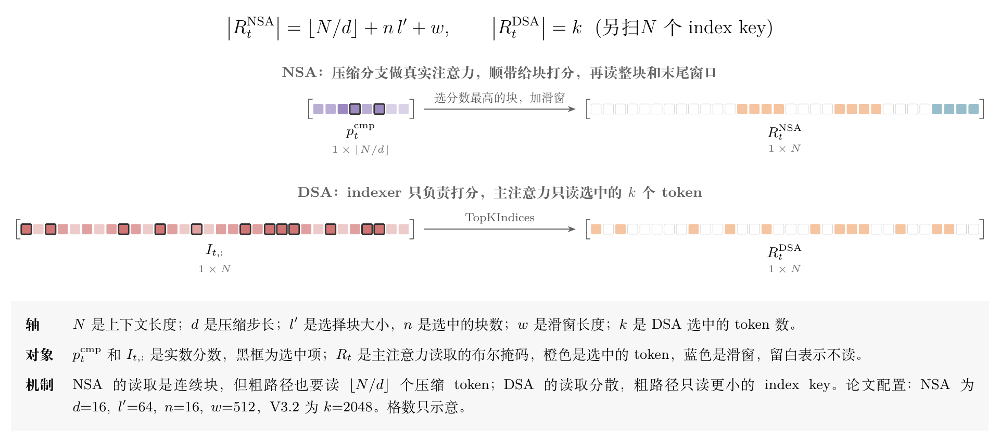
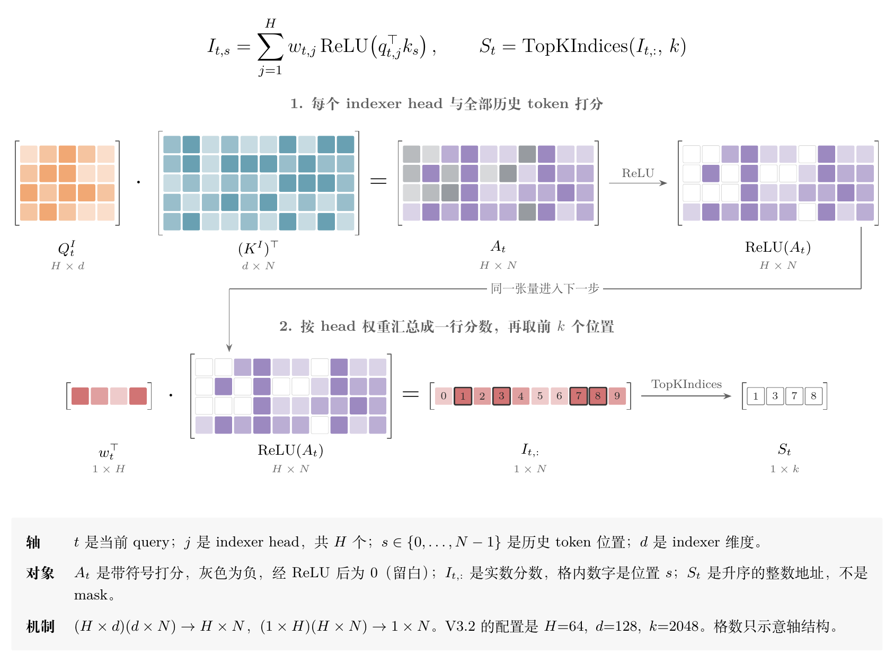
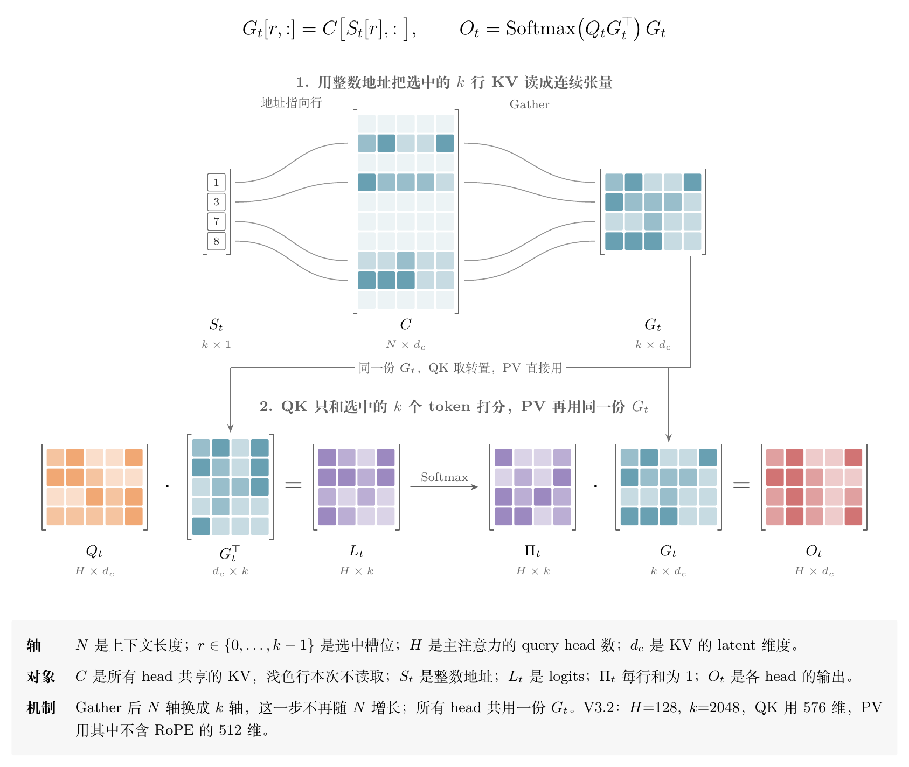

> 前置阅读：[注意力头设计](https://xuesongtap.github.io/2025/11/14/attention-head.html) · [Blackwell TMEM 与 tcgen05 MMA 深度解析](https://xuesongtap.github.io/2026/05/19/blackwell-tmem-tcgen05-mma.html)
>
> 资料核对于 2026-11-10，对应 FlashMLA 提交 `395cb3a`、DeepGEMM 提交 `5081f85`、DeepInfer 提交 `9bd9cf2`

2025 年 2 月，两篇块级稀疏注意力的论文几乎同时发布：DeepSeek 的 NSA 和月之暗面的 MoBA。[2][3]


NSA 专门解释了为什么要按连续的块来选：现代 GPU 读连续块的吞吐明显高于按索引随机读，按块计算也才能把 Tensor Core 用满。这也是当时的普遍看法，后来的综述总结得很直接：token 级的动态选择带来不规则访存，严重拖累 GPU 吞吐，于是块级稀疏成了主流。[14]


选择的块和 FlashAttention 式的 tile 正好对齐，块级看起来是更优雅的答案。

不到一年，风向变了。DeepSeek-V3.2 的 DSA（DeepSeek Sparse Attention）为每个 query 挑出 2048 个互不相邻的 token，[1] GLM-5 把 DSA 接进了 744B 的模型，[4] Kimi K3.1 Pro 也给全部 24 个全注意力层加上了 DSA，配置里同样是 `index_topk: 2048`。[5][6]

提出块级方案的两家，后来都没有继续用自己的方案。

硬件没有变，为什么是 DSA？


## 1. 同一个问题，两种分工

三种方案要解决的是同一件事：

一个 query 不必看全部历史，但得先知道该看哪里。

所以它们都是“粗扫全部历史，再精读少量 token”，差别在粗路径的做法和精读的单位。

MoBA 最直接。上下文切成块，query 和每块 key 的平均值做内积，按分数选 top-k 块，然后在选中的块内做普通注意力。[3]

NSA 更复杂，有三个分支。压缩分支把每 32 个 token 用一个可学习的 MLP 压成一个 key，步长 16，在这些压缩 token 上做真实的注意力，它的注意力分数顺带用来给块打分。选择分支读取分数最高的 16 个 64-token 块。滑窗分支读最近 512 个 token。三路结果用 gate 融合。[2]

所以 NSA 一次解码读取的量是 $\lfloor N/16\rfloor+1024+512$，论文给的 8K 时 2048、64K 时 5632 正好符合这个式子。[2]

DSA 把这件事拆得更干净：一个专门的 indexer 给所有历史 token 打分，选出前 $k$ 个，主注意力只读这些 token，没有压缩分支，也没有滑窗和 gate。



| | NSA | MoBA | DSA |
|---|---|---|---|
| 粗路径 | 约 $N/16$ 个压缩 token 上的真实注意力 | 块平均 key 的内积 | indexer 扫描全部 $N$ 个 token |
| 粗路径进入输出 | 是，经 gate 融合 | 否 | 否，只负责选 |
| 精读单位 | 64-token 块 | 块 | 单个 token |
| 新增结构 | 压缩 MLP、三分支、gate | 路由逻辑 | 一个 indexer 和它的 K 缓存 |

## 2. DSA 的 indexer

对当前 query 位置 $t$ 和历史位置 $s$，indexer 这样打分：[1]

$$
I_{t,s}=\sum_{j=1}^{H} w_{t,j}\,\operatorname{ReLU}\!\left(q_{t,j}^{\top}k_s\right)
$$

其中 $H$ 是 indexer 的头数，$q_{t,j}$ 和权重 $w_{t,j}$ 由当前 token 生成，$k_s$ 来自历史 token。有了分数，就取前 $k$ 大的位置 $S_t$，主注意力只读这些位置上的 KV。



官方配置里和它相关的就是这几项：[7]

```json
{
  "num_attention_heads": 128,
  "kv_lora_rank": 512,
  "qk_rope_head_dim": 64,
  "index_n_heads": 64,
  "index_head_dim": 128,
  "index_topk": 2048
}
```

indexer 便宜在哪里？头数只有主注意力的一半；维度是 128，而主注意力在 MLA 的 latent 空间里算，QK 是 $512+64=576$ 维，PV 是 512 维；它用 FP8 计算，还省掉了整个 PV 和 Softmax。


DeepGEMM 里这条路径写得很直接，每个 head 的累加结果过一次 ReLU，乘上 bf16 权重，再加到总分上：[12]

```cpp
sum_0 = __hfma2(ptx::cvt_relu_bf16x2_f32(accum_pair_0), chunk_weights[head_offset / 2], sum_0);
```

这里用 DeepInfer FLOPs 估算器的权重，FP8 记 2、BF16 记 4，[8] 算一个 query 和一个历史 token 之间的工作量：

$$
c_{\mathrm{idx}}=2\times 64\times 128=16384,\qquad
c_{\mathrm{main}}=4\times 128\times(576+512)=557056
$$

单价不到主注意力的 3%。这个 3% 后面还会用到。

## 3. Reason1: 能接到现有模型上

我认为这是最关键的一条。

DSA 的训练分两步。先是 dense warm-up：保持稠密注意力不变，冻结 indexer 以外的所有参数，把主注意力按 head 求和、归一化后的分数当目标，用 KL 散度训练 indexer。然后进入稀疏阶段，真实选取 2048 个 token，KL 只在选中集合上计算。

indexer 的输入从计算图上摘下来，它只由 KL 训练，主模型只看语言建模损失。[1] 这条自蒸馏的路线可以追溯到 SeerAttention。[14]

这个流程的价值在于：已经训好的稠密模型本身就是老师。V3.2 从 V3.1-Terminus 续训，warm-up 只有 1000 步，稀疏阶段用了 943.7B tokens。[1] GLM-5 的稀疏适配阶段只用了 20B tokens，长上下文指标就接近原来的 MLA 模型，四项 128K 测试是 100.0、97.0、86.0、63.0，MLA 是 100.0、95.5、79.7、66.3。[4]

更让人意外的是这个模块有多小。V3.2 权重里，每层 indexer 只有三个投影：`wq_b` 是 $8192\times 1536$，`wk` 是 $128\times 7168$，`weights_proj` 是 $64\times 7168$。全部 62 层加起来约 8.66 亿参数，而权重文件总共约 1.37 TB，按 BF16 折算约 6850 亿参数，indexer 只占千分之一点三左右。[17]

这么小的模块学得够好吗？GLM-5 做过一个很说明问题的实验：在 GLM-4.7-Flash 上只跑 warm-up，主模型权重完全冻结，只训练 indexer。RULER 在 64K 以内最多只掉 2.87 分，128K 从 79.21 掉到 71.35。再联合训练 150B tokens，128K 回到 78.86，只差 0.35 分。[4]


也就是说，判断“该看哪里”需要的信息量，比当时大家以为的要少得多，用不着压缩分支那样一整条真实的注意力路径。

K3.1 Pro 是更极端的例子。Kimi K3 是 69 层 KDA 线性注意力加 24 层 MLA 的混合结构，K3.1 Pro 保持这个布局不动，只给那 24 层加 indexer。[5][6]


DSA 在这里就是一个可以局部插入的模块。

NSA 很难这样接入。压缩 MLP 要学习，压缩分支的 KV 要单独缓存，gate 要和主干一起训练，它的名字里就写着 native trainable。论文的做法也是带着这个结构完成 270B tokens 的预训练。[2] NSA 自己的实验结果并不差，只是对一个已经花掉大量算力的模型来说，这是一个重得多的决定。

## 4. Reason2：选得更细，质量风险小

块级方法有一个结构性的问题：选择单位比需要的信息大。

NSA 的块分数来自压缩 key，32 个 token 先被压成一个向量，块内的差异在打分之前就已经模糊了。MoBA 的平均 key 也一样。选中一个 64-token 的块后，里面无关的 token 也要读，同样的预算买到的有效 token 更少。LongCat 的论文也是这样描述的：块级方法天然会模糊块内 token 的重要性差异，而 DSA 用独立的 indexer 和逐 token 打分，才接近无损。[13]

对模型厂来说，“接近无损”可能比“更省”更重要。GLM-5 比较过其他省算力的方案：把一半的层换成搜索出的滑窗模式，RULER 128K 掉 5.69 分；换成线性的 SimpleGDN，RepoQA 128K 掉 7.33 分。[4] 这组对比里没有 NSA，但能说明团队在意什么：能不能全层替换，并且不掉长上下文能力。

## 5. Reason3：随机读取的瓶颈，硬件在改善

NSA 的核心论据是随机读慢。这一点并没有错，变化的是处理方式。



$$
G_t[r,:]=C\big[S_t[r],:\big],\qquad
O_t=\operatorname{Softmax}\!\left(Q_tG_t^{\top}\right)G_t
$$

不规则只存在于读取那一步。一旦 $k$ 行 KV 被搬进 SMEM 的连续区域，Tensor Core 看到的就是一个普通的稠密 tile。

Blackwell 的 TMA 为此提供了 `gather4`：一次读取四个任意的行，合并到一个目标张量中。[9] 四个行号直接放在指令的坐标里。[10] FlashMLA 现在的 decode kernel 里，`B_TOPK=64` 个 token 组成一个 MMA 块，一块发 16 条 gather4：[11]

```cpp
for (int row = 0; row < B_TOPK; row += 4) {
    if (row+4 < B_TOPK)
        nxt_cur_indices = *(int4*)(plan.tma_coord[rs.index_buf_idx] + row + 4);
    ku::tma_gather4(
        tensor_map,
        plan.bar_raw_ready[rs.buf_idx],
        plan.u.kv.raw_quant[rs.buf_idx].data() + RAW_TOKEN_SMEM_STRIDE<F>*row,
        0,
        cur_indices,
        (int64_t)TMA::CacheHintSm90::EVICT_FIRST
    );
    cur_indices = nxt_cur_indices;
}
```

另一个前提是 KV 必须在 head 之间共享，否则取数量要乘上头数。NSA 已经意识到这点，它在 GQA 组内共享选择结果。[2] DSA 走得更彻底，用 MLA 的 MQA 模式，所有 query head 共用同一组 latent，选一次、读一次。论文也写明，kernel 层面每个 KV 条目必须被多个 query 共享。[1] 这里需要的是共享本身，选 MLA 的直接原因则是要从 V3.1-Terminus 续训。

排序也要专门写。$k=2048$ 时优先队列类算法耗时增长很快，TensorRT-LLM 用 radix select，候选少于 2048 后转并行排序。在 B200 上处理 $64\times 9295$ 的分数矩阵，平均 14.3 微秒，`torch.topk` 是 106.1 微秒。[9]

不过 gather4 只是缓解，随机读慢的问题还在。LongCat 分析过自家加速器上的情况：每个 token 单独 gather 一个 1152 字节的向量，只占约 50 个在途内存槽中的 3 个，有效带宽只有峰值的约 4.5%，稀疏注意力因此严重受限于内存。[13] 这部分账是 DSA 实打实付出去的，NSA 的连续读取在这里仍然占优。

gather4 也不是 DSA 的前提。V3.2 论文的成本曲线是在 H800 上部署服务测出来的。[1]

## 6. DSA 付出的代价

最大的代价在 indexer。它要给全部 $N$ 个 token 打分，主注意力只读固定的 $k$ 个，单个 query 的成本是：

$$
C(N)=c_{\mathrm{idx}}\,N+c_{\mathrm{main}}\,\min(N,k)
$$

$k$ 固定意味着稀疏率不是常数，上下文越长越稀疏。代入 $k=2048$，按 FLOPs 手算单层结果（不含 Top-K 和取数）：

| 上下文长度 $N$ | $k/N$ | indexer ÷ 主注意力 | indexer 占比 | DSA ÷ 稠密 MLA |
|---|---|---|---|---|
| 8K | 25% | 0.12 | 10.5% | 27.9% |
| 70K | 2.9% | 1 | 50% | 5.9% |
| 128K | 1.6% | 1.84 | 64.8% | 4.5% |
| 1M | 0.2% | 14.4 | 93.5% | 3.2% |

这和实测很接近。LongCat 在 $k=2048$ 的解码中测得，indexer 和稀疏注意力在约 100K 时持平，1024K 时 indexer 占单层延迟的 90%。[13]

所以 DSA 的节省有上限：$N$ 足够大时，总成本趋近稠密 MLA 的 $c_{\mathrm{idx}}/c_{\mathrm{main}}\approx 2.9\%$。论文也说得很明白，主注意力降到 $O(Lk)$，indexer 仍是 $O(L^2)$。[1]

实际节省也小于 FLOPs 账面。按上表，128K 时 DSA 的计算量只有稠密 MLA 的 4.5%，而 GLM-5 报告的是长序列 attention 计算减少约 1.5–2 倍，128K 时 GPU 成本减半；[4] K3.1 Pro 在长上下文解码时，每层读取的字节数约为稠密 MLA 的四分之一。[6]

两者的差距，大致就是取数、排序和内存瓶颈吃掉的部分。

训练时还有一笔账。反向传播的 `scatter_add` 落在不规则的位置上，不同的 core 写到相同区域时只能串行，LongCat 把这列为 token 级选择的额外代价。[13]


另外也有研究者认为，token 级方法只在大模型和 MLA 下才真正有效。[16] 这是竞争方案作者的看法，但也提醒我们，共识主要来自大规模的 MLA 模型。


## 参考

[1] DeepSeek-AI, *DeepSeek-V3.2: Pushing the Frontier of Open Large Language Models*, 2025，§2.1、§2.3. <https://arxiv.org/abs/2512.02556>

[2] Yuan et al., *Native Sparse Attention: Hardware-Aligned and Natively Trainable Sparse Attention*, 2025，§3.3、§3.4、§4–5. <https://arxiv.org/abs/2502.11089>

[3] Lu et al., *MoBA: Mixture of Block Attention for Long-Context LLMs*, 2025. <https://arxiv.org/abs/2502.13189>

[4] GLM-5 Team, *GLM-5: from Vibe Coding to Agentic Engineering*, 2026，§2.1. <https://arxiv.org/abs/2602.15763>

[5] Moonshot AI, Kimi-K3.1-Pro 官方配置，`config.json`. <https://huggingface.co/moonshotai/Kimi-K3.1-Pro/raw/main/config.json>

[6] Inferact and the vLLM Team, *vLLM Delivers Day-0 Support for Kimi K3.1 Pro*, 2026. <https://vllm.ai/blog/2026-11-04-kimi-k31-pro>

[7] DeepSeek-V3.2 官方配置，`config.json`. <https://huggingface.co/deepseek-ai/DeepSeek-V3.2/raw/main/config.json>

[8] DeepInfer，FLOPs 估算器，`csrc/engine/flops_estimator.hpp`. <https://github.com/deepseek-ai/DeepInfer/blob/9bd9cf243fc53ef9afbf8f04d391d989117d6ab9/csrc/engine/flops_estimator.hpp#L14-L20>

[9] NVIDIA TensorRT-LLM, *Optimizing DeepSeek-V3.2 on NVIDIA Blackwell GPUs*. <https://nvidia.github.io/TensorRT-LLM/blogs/tech_blog/blog15_Optimizing_DeepSeek_V32_on_NVIDIA_Blackwell_GPUs>

[10] FlashMLA，`tma_gather4`，`csrc/3rdparty/kerutils/include/kerutils/device/cuda/sm100/intrinsics.cuh`. <https://github.com/deepseek-ai/FlashMLA/blob/395cb3afbb331fef7b1b21e9340861b9436b42d8/csrc/3rdparty/kerutils/include/kerutils/device/cuda/sm100/intrinsics.cuh#L12-L23>

[11] FlashMLA，SM100 sparse decode kernel，`csrc/cuda_kernels/sm100/decode/sparse/head64/kernel.cuh`. <https://github.com/deepseek-ai/FlashMLA/blob/395cb3afbb331fef7b1b21e9340861b9436b42d8/csrc/cuda_kernels/sm100/decode/sparse/head64/kernel.cuh#L513-L590>

[12] DeepGEMM，SM100 MQA logits kernel，`deep_gemm/include/deep_gemm/impls/sm100_mqa_logits.cuh`. <https://github.com/deepseek-ai/DeepGEMM/blob/5081f8513af57e61696de4f4f04b0e707ffb503e/deep_gemm/include/deep_gemm/impls/sm100_mqa_logits.cuh#L480-L490>

[13] Zan et al., *LongCat Sparse Attention: Taming the Lightning via Streaming-aware Hierarchical Cross-Layer Indexing*, 2026，§1–2.3. <https://arxiv.org/abs/2608.01662>

[14] Sun et al., *Efficient Attention Mechanisms for Large Language Models: A Survey*, 2025. <https://arxiv.org/abs/2507.19595>

[15] DeepSeek-V4.1-Flash 官方配置，`config.json`. <https://huggingface.co/deepseek-ai/DeepSeek-V4.1-Flash/raw/main/config.json>

[16] *DashAttention: Differentiable and Adaptive Sparse Hierarchical Attention*, 2026，Related Work. <https://arxiv.org/abs/2605.18753>

[17] DeepSeek-V3.2 官方权重索引与 safetensors 文件头（`self_attn.indexer.*`），参数量由张量形状相加得到. <https://huggingface.co/deepseek-ai/DeepSeek-V3.2/blob/main/model.safetensors.index.json>
