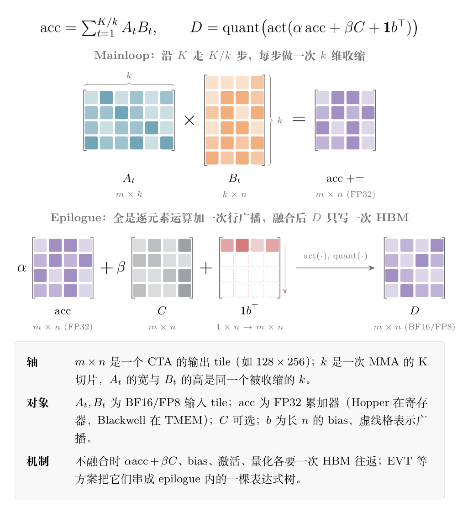
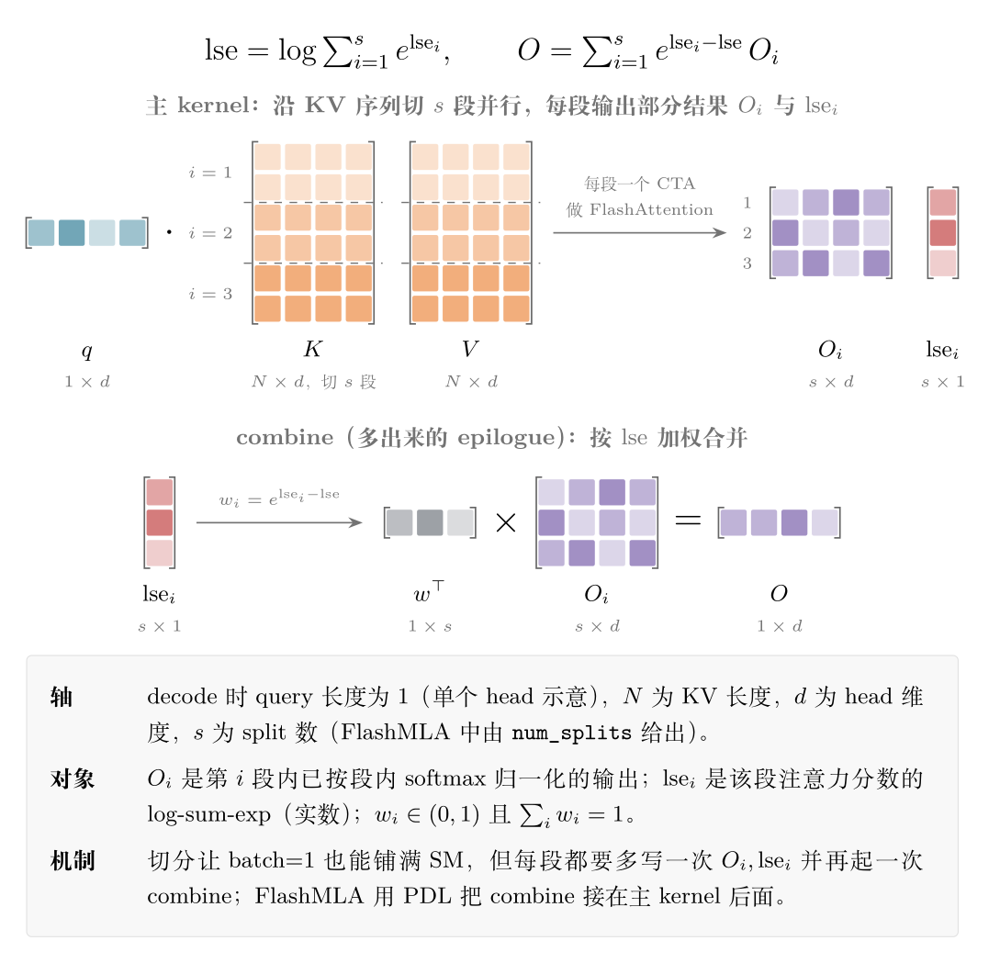
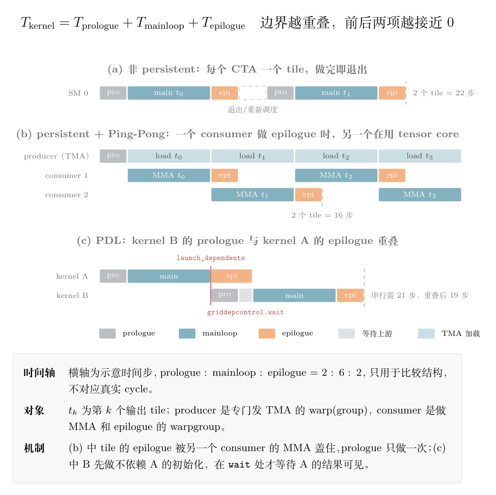
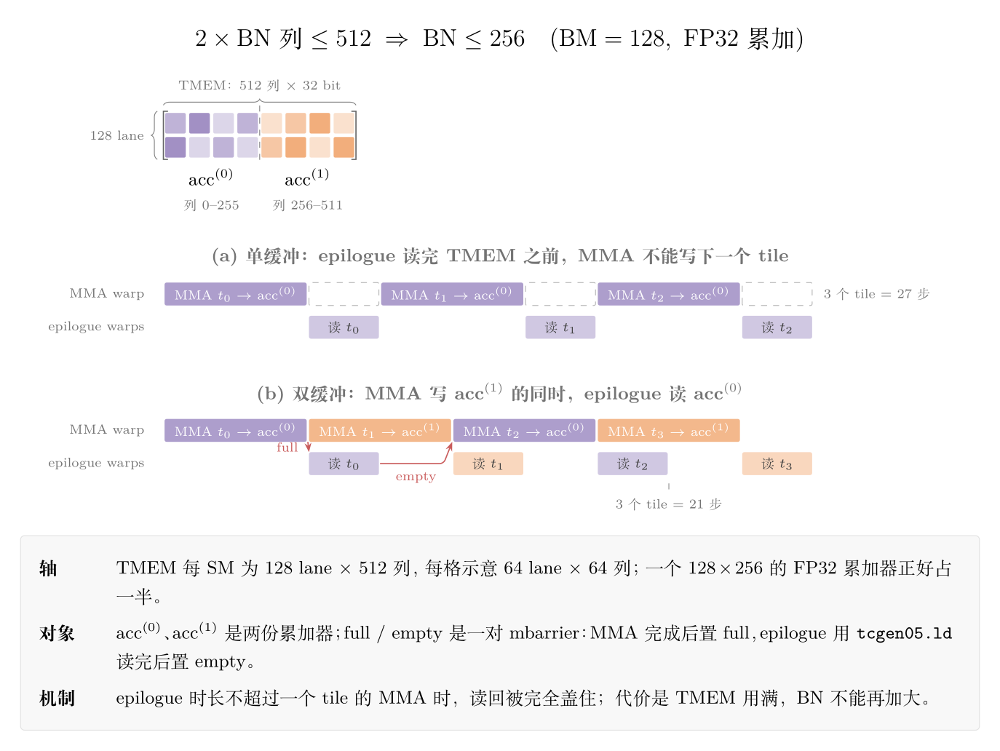
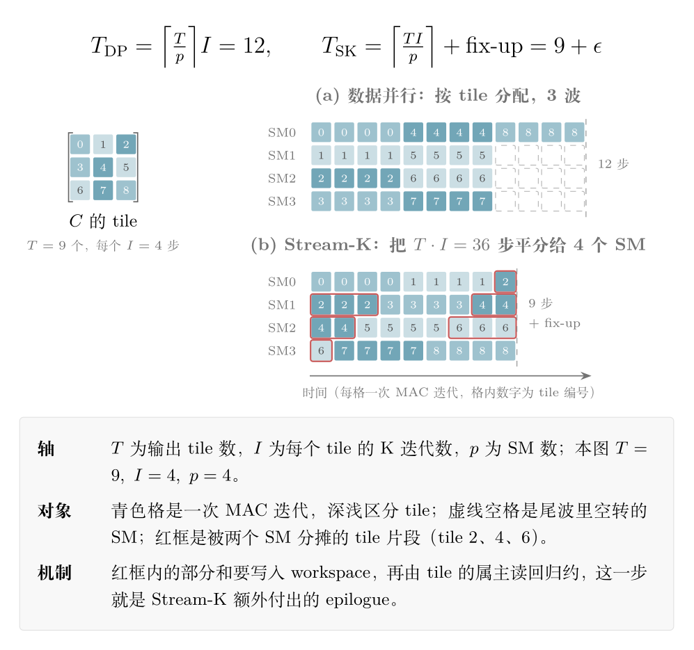

> 前置阅读：[理解 CUTLASS 的 CLC dynamic persistent kernel]() · [Blackwell TMEM 与 tcgen05 MMA 深度解析]() · [MegaMoE：EP token 流动与通信计算重叠]() · [FlashAttention 的空行 LSE]()

## 1. 一个 kernel 的三段式

几乎所有 tile 化的 GEMM / attention kernel 都可以切成三段：

```
时间轴 →

[ prologue ] → [ mainloop（稳态） ] → [ epilogue ]
  建 barrier       K 维（或 KV）循环        累加器收尾
  取 descriptor    TMA load + MMA           rescale / 激活 / cast
  预取首批 tile    softmax 与 MMA 重叠       写回 HBM
```

- **Prologue：把流水线灌满。** 初始化、建同步原语、发出第一批异步加载。
  在这一段里，tensor core 基本是闲着的。
- **Mainloop：稳态。** 多级 pipeline 让访存和计算重叠，也是所有教程的主角
  （CUTLASS 文档里的 double buffering 示意图 [6]、Colfax 的 pipelining 教程 [2]、
  Simon Boehm 那篇经典 worklog [16] 讲的都是它）。
- **Epilogue：把结果收干净。** 累加器出寄存器 / TMEM，做 scale、bias、激活、量化，
  最后写回全局内存。CUTLASS 的文档把它定义为“一个独立阶段，线程先经 shared memory
  交换数据，再用 striped 的方式协作写全局内存” [6]。


## 2. 为什么过去没人在意，现在又在意了

### 2.1 大 shape：Amdahl 站在 mainloop 一边

M=N=K=8192 的 GEMM，每个 CTA 的 K 循环要跑上百次迭代，prologue/epilogue 加起来可能只有
几个百分点。这时候优化 mainloop 就是最划算的事。

这背后是 Amdahl 定律 [46]：如果只加速程序中占比为 $p$ 的那部分，加速 $s$ 倍，
整体加速比为 $S = 1 / \left((1-p) + p/s\right)$。就算 $s \to \infty$，整体也只能快 $1/(1-p)$ 倍，
没被加速的部分决定了上限。大 shape 下 mainloop 的 $p$ 接近 1，所以优化它几乎等价于优化整个 kernel。

### 2.2 但 mainloop 越快，边界越显眼

Amdahl 定律在这里会反过来起作用。设边界（prologue + epilogue）占比为 $b$，mainloop 加速 $s$ 倍后，
边界在总时间中的新占比为：

$$
b' = \frac{b}{b + (1-b)/s}
$$

代入 $b = 10\%$：

- 把 mainloop 优化 2 倍：总时间变成 10% + 45% = 55%。这时 prologue/epilogue 的占比
  从 10% 涨到了 **18%**。
- 再把 mainloop 优化 2 倍：10% + 22.5% = 32.5%，占比涨到 **31%**。

mainloop 被优化得越狠，边界在总时间里的比例就越大。从 Hopper 到 Blackwell，
tensor core 吞吐翻了几倍，prologue/epilogue 却没有同比变快，所以它们自然越来越显眼。

### 2.3 小 shape：decode、小 batch、MoE

- **Decode GEMM**：M = 1/16/64，K 循环很短，每个 tile 的 prologue/epilogue 摊不开。
- **MoE**：每个 expert 分到的 token 少，大量小 GEMM，边界数量成倍增加。
- **Attention decode**：query 长度通常是 1，FlashAttention 只沿 batch 和 query block
  并行，batch=1 时连 1% 的 GPU 都用不满，这正是 Flash-Decoding 出现的原因 [24]
  沿 KV 切分之后，每个 split 都要额外写一次 partial O 和 LSE，再由 combine 收尾
  也就是**多出了一段 epilogue**。

在这些场景里，prologue/epilogue 占到 20–40% 并不罕见

## 3. GEMM：两段里到底装了什么

### 3.1 Prologue

- 累加器清零（Hopper 在寄存器里，Blackwell 在 TMEM 里 [9][40]）；
- 取 TMA descriptor（可以 `prefetch.tensormap` 提前取）、初始化 mbarrier 和 pipeline stage；
- 分配 TMEM（Blackwell `tcgen05.alloc`）；
- warp specialization 的角色分工：producer warp 负责 TMA，consumer warp 负责 MMA [2][10]；
- cluster launch 时建立 cluster barrier / DSMEM，必要时为 TMA multicast 做准备 [27]；
- PDL 的 dependent kernel 要在读上游结果前 `cudaGridDependencySynchronize()` [19]；
- 预取第一批 A/B tile，把 pipeline 的前几级灌满。

### 3.2 Epilogue

现代 GEMM 的 epilogue 远不止“写个 C”：

```
D = activation(alpha * acc + beta * C + bias)
D = quantize(D)            // FP32 → BF16 / FP8，可能还要算 per-block scale
store(D)                   // TMA store 或普通 store
```

此外还可能有 split-K 的 reduction、行/列 reduction（例如给 LayerNorm 或 loss 准备统计量）、
SwiGLU 这种双输入激活，乃至 TP 场景下的通信。EVT 论文正是因为训练图里的 normalization、
loss、reduction 很难融进 GEMM，才提出用“visitor tree”去组合 epilogue [4]。



mainloop 只做一件事：沿 $k$ 收缩。epilogue 里全是逐元素运算和一次 bias 的行广播，
不涉及任何收缩，所以很适合融合到同一个 kernel 里，避免中间结果落回 HBM。

### 3.3 骨架

```cpp
__global__ void gemm_kernel(...) {
    // ---- prologue ----
    init_barriers();
    prefetch_tma_descriptors();
    zero_accumulator();
    for (int s = 0; s < STAGES - 1; ++s) issue_tma_load(s);   // 灌流水线

    // ---- mainloop ----
    for (int k = 0; k < K_TILES; ++k) {
        wait_stage(k);
        mma(k);
        issue_tma_load(k + STAGES - 1);
    }

    // ---- epilogue ----
    wait_mma_done();
    auto d = activation(alpha * acc + beta * load_c() + bias);
    tma_store(quantize(d));
}
```


## 4. Attention：容易被低估的收尾

### 4.1 Prologue

- 加载 Q tile；
- online softmax 的状态初始化：`m = -inf`、`l = 0` [22]；
- 建立 K/V 的 TMA / pipeline，预取第一块 K/V；
- split-KV 时读调度 metadata（FlashMLA 的 `get_mla_metadata` 会预先算好
  `tile_scheduler_metadata` 和 `num_splits` [26]）；
- PDL 的 dependent kernel 在此等待上游。

### 4.2 Epilogue

```cpp
float inv_l = 1.0f / l;
for (int i = 0; i < D; ++i) O[i] = acc[i] * inv_l;   // 最终 rescale
float lse = m + logf(l);                              // backward / combine 需要
// 处理全 mask 行：l == 0 时避免 0/0；LSE 填 +inf 还是 -inf 各实现约定不同
// （FA-2 / FlashMLA 用 +inf，详见前置阅读里的空行 LSE 一文）
store_O_and_LSE(cast<bf16>(O), lse);
```

split-KV（Flash-Decoding [24]、FlashInfer [25]、FlashMLA [26]）时还要写 `O_accum` /
`lse_accum`，再由 combine kernel 做一次 log-sum-exp 加权合并。FlashMLA 的 combine
还用 PDL 把它和主 kernel 首尾相接。



combine 的权重 $w_i=e^{\mathrm{lse}_i-\mathrm{lse}}$ 恰好是各段 softmax 分母在全局分母中的占比，
所以 $\sum_i w_i O_i$ 和不切分时直接算出来的 $O$ 完全相等。切分换来的并行度，
代价就是每段多一次 $O_i$、$\mathrm{lse}_i$ 的写回，以及一个额外的 combine kernel。

---

## 5. 边界开销从哪来：四种“空泡”

把 prologue/epilogue 的成本拆开看，大概有四类：

| 空泡 | 产生原因 | 典型对策 |
|---|---|---|
| **每 CTA 的初始化** | 每个 CTA 都要重新建 barrier、取 descriptor、分配 TMEM | persistent kernel 只做一次 |
| **流水线 fill / drain** | 灌满前和排空后 tensor core 空转 | 跨 tile overlap，ping-pong，累加器双缓冲 |
| **Wave quantization / tail** | tile 数不是 SM 数的整数倍，最后一波只有少数 SM 在干活 | persistent + 动态调度，Stream-K |
| **Kernel 边界** | launch 延迟，上一个 kernel 的尾巴和下一个的头部不能重叠 | PDL，CUDA Graph，megakernel |

wave quantization 值得多说一句。NVIDIA 的 *Matrix Multiplication Background* 指南
专门讨论了 tile quantization 和 wave quantization [17]。一个经典的例子是：A100 有 108 个 SM，
如果要调度 109 个 thread block，就得跑两波，第二波只有 1 个 block，耗时却和第一波差不多 [41]。
Nsight Compute 的 Launch Statistics 会给出 “Waves Per SM”，看到 1.6 这种带小数的值，
就说明尾波可能吃掉了相当一部分时间 [18]。

下图把这几类空泡放在同一条时间轴上，对比三种情况：非 persistent、persistent + Ping-Pong、PDL。
后面三节讲的手段，都可以在这张图里找到自己的位置。



---

## 6. 核心手段一：Persistent kernel 与跨 tile overlap

### 6.1 非 persistent

每个 CTA 算一个输出 tile，算完就退出：

```
CTA 0: [prologue][mainloop][epilogue] 退出
CTA 1: [prologue][mainloop][epilogue] 退出
...
```

每个 tile 都要付一次完整的 prologue，epilogue 也只能串行跑在最后。tile 之间有
drain/refill 空泡，最后一波还可能只有一半 SM 在干活。

### 6.2 Persistent

grid 固定为 SM 数（每个 SM 一个 CTA），CTA 在内部循环处理多个 tile [1][14]：

```
CTA 0: [pro][main tile0][epi tile0]
                  [load tile1][main tile1][epi tile1]
                                [load tile2][main tile2] ...
```

收益来自四个方面：

1. **初始化只做一次**：barrier、descriptor、TMEM 分配都摊到多个 tile 上。PyTorch 关于
   Ping-Pong 的文章说得很直白：persistent 的设计目的就是 *amortize launch and prologue
   overhead* [10]。
2. **epilogue 和下一个 tile 的加载重叠**：producer warp 不用等 consumer 写完 C，
   就可以开始拉下一个 tile 的 A/B。
3. **流水线不排空**：CTA 不退出，pipeline 状态在 tile 之间延续。
4. **调度更灵活**：tile scheduler 可以按 swizzle / Hilbert 曲线排 tile 顺序，改善 L2 命中率
   （Pranjal 的 H100 worklog 用 Hilbert 曲线排 tile，最终在 N=4096 上比 cuBLAS 快约 7% [15]），
   也可以接 Stream-K 来消除尾波。

这几项各自的收益不大，叠在一起，在中等 shape 上通常就能拿到几个百分点。
Triton 的 persistent matmul 教程可以直接对比 naive、persistent、TMA persistent 几种写法的
吞吐差异 [14]。

### 6.3 Hopper：Cooperative vs Ping-Pong

CUTLASS 在 Hopper 上有两种 warp-specialized persistent 调度 [7][10]：

- **Cooperative**：两个 consumer warpgroup 合算**同一个**输出 tile。tile 大，但 epilogue
  期间两个 consumer 都在写回，tensor core 闲着。
- **Ping-Pong**：两个 consumer 各算**不同的**输出 tile，轮流使用 tensor core。
  一个在做 MMA 时，另一个在做 epilogue，然后两者交换。**epilogue 被藏在了另一个 tile 的
  mainloop 后面。**

FA3 把同样的思路用在 attention 上：一个 warpgroup 做 softmax 时，另一个做 GEMM [23]。

还有一个细节：persistent Ping-Pong 下 epilogue 用的 shared memory 不能再和 A/B 的
buffer 复用（非 persistent 时可以），所以 SMEM 预算会更紧 [12]。

### 6.4 Blackwell：TMEM 累加器双缓冲

Blackwell 的累加器放在 TMEM 里，每个 SM 有 128 lane × 512 column [9][40]。
MMA 由单线程发出，epilogue warp 通过 `tcgen05.ld` 把结果从 TMEM 读到寄存器。
这让一种更干净的重叠方式成为可能：**把累加器在 TMEM 里开两份**。MMA warp 往 buffer B
里算 tile i+1 的同时，epilogue warp 从 buffer A 里取出 tile i 并写回。

代价是 TMEM 容量。一个 128×256 的 FP32 累加器占 256 列，双缓冲就是 512 列，
正好用满整个 TMEM [40]。这就是 tile 大小、双缓冲和 2-CTA MMA 之间要做的权衡。
另外，epilogue 必须等 MMA 完成的 barrier 触发之后再读 TMEM，否则读到的是半成品 [40]。
Tilus 的 Blackwell matmul 教程完整演示了 TMEM → 寄存器 → SMEM → TMA store 这条
epilogue 路径 [39]。



单缓冲时，epilogue 读 TMEM 期间 MMA 只能干等；双缓冲后，MMA 写一份、epilogue 读另一份，
由 full / empty 两个 mbarrier 交接。只要 epilogue 的读回不比一个 tile 的 MMA 慢，
它就被完全藏起来了。

### 6.5 Stream-K：从根上消灭尾波

persistent + 静态 tile 分配仍然可能有尾波：tile 数除以 SM 数有余数。Stream-K 换了个思路：
不按 tile 平分，而是把**全部 MAC 迭代**平均分给每个 SM（误差在一次迭代以内），
跨 tile 边界的部分再做一次 fix-up reduction [5]。论文在 32,824 个 GEMM shape 上做了评测，
相对同 blocking 的 data-parallel 版本最高快 14 倍。Colfax 的教程对比了 Split-K 和 Stream-K，
并分析了 CUTLASS 里的 Stream-K 实现 [1]。



以 9 个 tile、每个 tile 4 次 K 迭代、4 个 SM 为例：数据并行要跑 $\lceil 9/4\rceil=3$ 波，
最后一波只有 SM0 在干活，总共 12 步；Stream-K 把 36 次迭代平分，每个 SM 9 步，
代价是 tile 2、4、6 被切到了两个 SM 上，需要额外的 fix-up。

需要注意的是，Stream-K 本身会引入 workspace 读写和跨 CTA 同步，**相当于又多了一段
epilogue**。所以实践中通常是“数据并行 + 尾部 Stream-K”的混合策略，而不是全量 Stream-K。

---

## 7. 核心手段二：让 epilogue 本身变轻

### 7.1 Epilogue fusion

最直接的收益来自省掉一次 HBM 往返。bias、激活、量化、残差如果放在单独的 kernel 里，
就要把 D 写出去再读回来。

- **CUTLASS EVT**：CUTLASS 3.2 起支持 Hopper TMA epilogue 上的 EVT，可以用树状组合
  自定义 epilogue，不用从头写一个 [3][4]。常见的组合已经在
  `include/cutlass/epilogue/fusion/operations.hpp` 里预置好了 [3]。
- **SwiGLU 这类双输入激活**：fal 的博客演示了怎么用自定义 visitor 写 gated SiLU [37]。
  微软一篇 2026 年的论文把 SwiGLU 在 tile 级别融进 SM90 GEMM，指出中间张量落 HBM 占了
  MLP 时间的 9–37% [35]。
- **CODA** 在 CUTLASS mainloop 之上提供可组合的 epilogue 原语（scale、reduction、
  pairwise 变换、accumulation），并明确指出：在现代流水线调度下，epilogue 常常可以被放进
  其他 tile mainloop 的“阴影”里 [36]。

### 7.2 异步写回

- **TMA store**：发出后就可以继续干别的，只在复用 SMEM buffer 之前等它完成
  （`cp.async.bulk.wait_group.read`）；
- **向量化 cast**：FP32 → BF16/FP8 批量用 `cvt` 打包，减少指令数；
- **分块写回**：epilogue 按 subtile 切片，边 `tcgen05.ld` 边 store，降低寄存器峰值。

### 7.3 Fusion 的边界

不是融得越多越好。epilogue 太重会占用大量寄存器，挤压 mainloop 的 occupancy 或
pipeline 级数。CUTLASS 的文档提到，累加器通常已经占掉一个线程至少一半的寄存器预算 [6]。
需要全局 reduction 的 epilogue（比如完整的 LayerNorm）也不一定适合塞进单个 tile 里。

---

## 8. 核心手段三：消灭 kernel 之间的边界

前面讨论的是 kernel **内部**的边界。kernel **之间**也存在同样的结构：
上一个 kernel 的 epilogue 后面紧跟着下一个 kernel 的 prologue。

### 8.1 PDL：让两个 kernel 首尾相接

Programmatic Dependent Launch（sm_90+）允许 secondary kernel 在 primary 还没结束时
就启动 [19][8]：

- primary 在合适的时机调用 `cudaTriggerProgrammaticLaunchCompletion()`
  （PTX 里是 `griddepcontrol.launch_dependents`）；
- secondary 先做不依赖上游的 prologue（建 barrier、取 descriptor、读权重），
  再调用 `cudaGridDependencySynchronize()`（`griddepcontrol.wait`）等待上游的结果可见；
- 两个 kernel 的边界就此重叠。

需要注意两点：一是 overlap 是**机会性的**，官方文档明确说不保证一定发生 [19]；
二是 `cudaGridDependencySynchronize()` 之前读到的上游数据**没有可见性保证**。
如果在 sync 之前用 `ld.global.nc` 读上游刚写的数据，就会踩坑。

### 8.2 CUDA Graph

CUDA Graph 用一次 CPU 调用提交整串 GPU 操作，砍掉的是 CPU 侧的 launch 开销 [20][21]。
它**不改变** kernel 内部的 prologue/epilogue，也不让相邻 kernel 重叠，
所以和 PDL 是互补关系（PDL 也可以通过 programmatic edge 放进 graph 里 [19]）。

### 8.3 Megakernel：把整个模型变成一个 persistent kernel

把这个思路推到极致，就是把一整层甚至整个模型的前向融进一个 persistent kernel。
这样做的目的，就是把所有 kernel 边界都变成 kernel 内部的 tile 边界，再用前面讲的
跨 tile overlap 把它们藏起来。

- **Hazy Research “Look Ma, No Bubbles!”**：在 ThunderKittens [31] 上实现了一个片上解释器，
  把 Llama-1B 的整个前向放进一个 kernel，让一条“指令”的尾巴和下一条的头部重叠 [29]。
  后续还有面向吞吐的 TP Llama-70B 版本 [30]。
- **ThunderMLA**：针对 MLA decode 的融合 megakernel，同时处理 launch 开销和 kernel 之间的
  tail effect [33]。
- **Mirage Persistent Kernel (MPK, OSDI'26)**：编译器自动把多 GPU 推理 lower 成 SM 级的
  task graph，跑在一个 persistent kernel 里，相对 kernel-per-operator 的方案端到端延迟
  最高降低 1.7 倍 [32]。
- **Cohere 的开源 megakernel**：在 Hazy 的基础上，利用上一层的尾巴预取下一层的权重，
  把原本闲置的带宽用起来 [34]。
- **DeepGEMM MegaMoE**：MoE 版的 megakernel，把 EP dispatch、Linear 1、SwiGLU、
  Linear 2 和 EP combine 放进同一个 kernel，让 NVLink 通信和 tensor core 计算重叠 [43][44]。
  原本每个阶段各自一套 prologue/epilogue，外加一次 kernel 边界；融合后，上一阶段的 epilogue
  （比如 Linear 1 的 SwiGLU 和写回）直接喂给下一阶段，scheduler 再把 Linear 1 / Linear 2
  的块交错排布，用 Linear 1 的预热去填 Linear 2 的空档 [45]。

代价也很明显：调度复杂、调试困难、对不规则负载敏感。megakernel 的收益要和
“persistent 单算子 + PDL + CUDA Graph”这样的强 baseline 比才有意义，MPK 论文报告的
最高 1.7 倍，对比对象就是 kernel-per-operator 的推理系统 [32]。

---

## 9. 什么时候不该做

- **大 shape**：mainloop 占绝对主导，折腾边界的收益很小；
- **资源紧张**：persistent + 双缓冲 + 重 epilogue 会吃掉 SMEM / 寄存器 / TMEM，
  反过来伤害 mainloop（少一级 pipeline 可能比省掉一次 prologue 更亏）；
- **正确性风险**：跨 tile overlap 和 PDL 很容易引入 barrier 死锁、race、内存可见性问题；
- **负载不规则**：静态 persistent 调度对动态 shape、MoE 的路由偏斜不友好，
  这时需要动态调度或 work stealing；
- **工程成本**：一个 CUTLASS 风格的 persistent warp-specialized kernel，复杂度比
  朴素实现高一个数量级。Triton 的 persistent matmul 教程 [14] 和 TileLang [38] 这类 DSL
  正在降低这个门槛。

---

## 10. 怎么测

**先测量，再决定要不要优化边界。**

### 10.1 Nsight Compute

- **Launch Statistics**：看 Waves Per SM，小数部分越接近 0.x 的低值，尾波越严重 [18]；
- **Occupancy**：理论 occupancy 和实际 occupancy 差距大，通常说明负载不均 [18]；
- **Warp stall reasons**（`smsp__pcsamp_warps_issue_stalled_*`）：如果 barrier / long scoreboard
  类 stall 集中在 kernel 开头和结尾的 PC 上，就说明是边界在拖时间；
- **Source view**：按 SASS 行看 stall 分布，prologue 和 epilogue 的代码段一眼就能分出来。

### 10.2 Kernel 内打点

在三段的边界插 `clock64()`（SM 内的 cycle 计数）或 `%globaltimer`（跨 SM 可比的纳秒时间戳）：

```cpp
uint64_t t0 = clock64();   // prologue 开始
// ...
uint64_t t1 = clock64();   // mainloop 开始
// ...
uint64_t t2 = clock64();   // epilogue 开始
// ...
uint64_t t3 = clock64();   // 结束
if (threadIdx.x == 0) record(blockIdx.x, t0, t1, t2, t3);
```

把每个 CTA 的时间段画成甘特图，prologue 有多长、epilogue 有多长、尾波有多空，
都能直接看出来。

### 10.3 A/B 对比

最可靠的办法仍然是控制变量：非 persistent 对比 persistent，有 epilogue fusion 对比没有，
开 PDL 对比不开。在**目标 shape** 上看 kernel 总时间，而不是看大 shape 的 TFLOPS。

---

## 11. 结语

- **Prologue 灌流水线，epilogue 排流水线**。这两段时间里 tensor core 都在闲着。
- mainloop 越快、shape 越小，这两段的占比越大。在 decode 和 MoE 的时代，
  它们已经不再是“几个点”的问题。
- 业界的手段可以分三层：**kernel 内**用 persistent + 跨 tile overlap（Ping-Pong、
  TMEM 双缓冲、Stream-K）；**epilogue 本身**用 fusion 和异步写回；**kernel 间**用 PDL、
  CUDA Graph 和 megakernel。
- 这三层做的都是同一件事：**减少边界，或者把边界藏到别的工作后面。**

### 还没想清楚的问题

- persistent 跨 tile 在什么 occupancy / tile 数下收益最大？有没有简单的预测模型？
- TMEM 双缓冲和更大 tile / 2-CTA MMA 之间，什么时候选哪一个？
- epilogue fusion 什么时候应该拆回独立 kernel？
- PDL 和 persistent kernel 叠加使用时，trigger 放在哪里最合适？
- megakernel 相对“persistent 单算子 + PDL + CUDA Graph”的组合，真实增量有多大？

---

## 参考

**GEMM 设计与 CUTLASS**

1. Colfax Research. *CUTLASS Tutorial: Persistent Kernels and Stream-K.* https://research.colfax-intl.com/cutlass-tutorial-persistent-kernels-and-stream-k/
2. Colfax Research. *CUTLASS Tutorial: Efficient GEMM Kernel Designs with Pipelining.* https://research.colfax-intl.com/cutlass-tutorial-design-of-a-gemm-kernel/
3. Colfax Research. *Epilogue Fusion in CUTLASS with Epilogue Visitor Trees.* https://research.colfax-intl.com/epilogue_visitor_tree/
4. Chen et al. *EVT: Accelerating Deep Learning Training with Epilogue Visitor Tree.* ASPLOS 2024. https://aminer.org/pub/6629d8c501d2a3fbfcdf4348
5. Osama, Merrill, Cecka, Garland, Owens. *Stream-K: Work-centric Parallel Decomposition for Dense Matrix-Matrix Multiplication on the GPU.* PPoPP 2023. https://arxiv.org/abs/2301.03598
6. NVIDIA CUTLASS Docs. *Efficient GEMM in CUDA.* https://docs.nvidia.com/cutlass/latest/media/docs/cpp/efficient_gemm.html
7. NVIDIA Developer Blog. *CUTLASS 3.x: Orthogonal, Reusable, and Composable Abstractions for GEMM Kernel Design.* https://developer.nvidia.com/blog/cutlass-3-x-orthogonal-reusable-and-composable-abstractions-for-gemm-kernel-design/
8. NVIDIA CUTLASS Docs. *Dependent kernel launches.* https://docs.nvidia.com/cutlass/4.5.1/media/docs/cpp/dependent_kernel_launch.html
9. NVIDIA CUTLASS Docs. *tcgen05 MMA Programming Guide.* https://docs.nvidia.com/cutlass/latest/media/docs/pythonDSL/guides/mma/tcgen05_programming.html
10. PyTorch Blog. *Deep Dive on CUTLASS Ping-Pong GEMM Kernel.* https://pytorch.org/blog/cutlass-ping-pong-gemm-kernel/
11. PyTorch Blog. *Deep Dive on the Hopper TMA Unit for FP8 GEMMs.* https://pytorch.org/blog/hopper-tma-unit/
12. Simon Veitner. *PingPong in the CuTeDSL with QuACK.* https://veitner.bearblog.dev/pingpong-in-the-cutedsl-with-quack/
13. Simon Veitner. *Persistent Float8 Dense GEMM on Hopper.* https://veitner.bearblog.dev/persistent-float8-dense-gemm-on-hopper/
14. Triton Tutorials. *Persistent Matmul.* https://triton-lang.org/main/getting-started/tutorials/09-persistent-matmul.html
15. Pranjal Shankhdhar. *Outperforming cuBLAS on H100: a Worklog.* https://cudaforfun.substack.com/p/outperforming-cublas-on-h100-a-worklog
16. Simon Boehm. *How to Optimize a CUDA Matmul Kernel for cuBLAS-like Performance: a Worklog.* https://siboehm.com/articles/22/CUDA-MMM
17. NVIDIA. *Matrix Multiplication Background User's Guide*（tile / wave quantization 章节）. https://docs.nvidia.com/deeplearning/performance/pdf/Matrix-Multiplication-Background-User-Guide.pdf

**CUDA 运行时与工具**

18. NVIDIA. *Nsight Compute Profiling Guide.* https://docs.nvidia.com/nsight-compute/ProfilingGuide
19. NVIDIA. *CUDA Programming Guide: Programmatic Dependent Launch and Synchronization.* https://docs.nvidia.com/cuda/cuda-programming-guide/04-special-topics/programmatic-dependent-launch.html
20. NVIDIA Developer Blog. *Getting Started with CUDA Graphs.* https://developer.nvidia.com/blog/cuda-graphs/
21. NVIDIA Developer Blog. *Constant Time Launch for Straight-Line CUDA Graphs and Other Performance Enhancements.* https://developer.nvidia.com/blog/constant-time-launch-for-straight-line-cuda-graphs-and-other-performance-enhancements

**Attention**

22. Tri Dao. *FlashAttention-2: Faster Attention with Better Parallelism and Work Partitioning.* https://arxiv.org/abs/2307.08691
23. Shah, Bikshandi, Zhang, Thakkar, Ramani, Dao. *FlashAttention-3: Fast and Accurate Attention with Asynchrony and Low-precision.* https://arxiv.org/abs/2407.08608 ；博客：https://tridao.me/blog/2024/flash3/
24. Dao, Haziza, Massa, Sizov. *Flash-Decoding for long-context inference.* https://crfm.stanford.edu/2023/10/12/flashdecoding.html
25. Ye et al. *FlashInfer: Efficient and Customizable Attention Engine for LLM Inference Serving.* MLSys 2025. https://arxiv.org/abs/2501.01005
26. DeepSeek. *FlashMLA.* https://github.com/deepseek-ai/FlashMLA
27. DeepSeek. *DeepGEMM.* https://github.com/deepseek-ai/DeepGEMM
28. Modal. *We reverse-engineered Flash Attention 4.* https://modal.com/blog/reverse-engineer-flash-attention-4

**Megakernel 与 persistent 运行时**

29. Hazy Research. *Look Ma, No Bubbles! Designing a Low-Latency Megakernel for Llama-1B.* https://hazyresearch.stanford.edu/blog/2025-05-27-no-bubbles
30. Hazy Research. *How Many Llamas Can Dance in the Span of a Kernel?* https://hazyresearch.stanford.edu/blog/2025-09-28-tp-llama-intro
31. Spector et al. *ThunderKittens: Simple, Fast, and Adorable AI Kernels.* https://arxiv.org/abs/2410.20399
32. Cheng et al. *MPK: A Compiler and Runtime for Mega-Kernelizing Tensor Programs.* OSDI 2026. https://arxiv.org/abs/2512.22219 ；代码：https://github.com/mirage-project/mirage
33. ThunderMLA 介绍（二手总结）. https://blog.gopenai.com/thundermla-optimizing-llm-inference-flashmla-faster-and-fused-er-bddabfb8daac ；代码见 https://github.com/HazyResearch/ThunderKittens
34. Cohere. *Megakernels.* https://cohere.com/blog/megakernels

**Epilogue fusion 的近期工作**

35. Jangda et al. *Tile-Level Activation Overlap for Efficient LLM Inference.* https://arxiv.org/abs/2607.02521
36. *CODA: composable epilogue primitives on CUTLASS.* https://arxiv.org/abs/2605.19269
37. fal.ai. *Crafting Efficient Kernels with Epilogue Fusion.* https://blog.fal.ai/crafting-efficient-kernels-with-epilogue-fusion

**DSL 与 Blackwell**

38. Wang et al. *TileLang: A Composable Tiled Programming Model for AI Systems.* https://arxiv.org/abs/2504.17577
39. NVIDIA Tilus. *Matmul on Blackwell: Multi-Stage Software Pipelining.* https://nvidia.github.io/tilus/latest/tutorials/matmul-blackwell/v2.html
40. Mohak Chugh. *tcgen05, Tensor Memory and Blackwell's single-thread MMA.* https://mohakchugh.is-a.dev/blog/tcgen05-tensor-memory-blackwell-single-thread-mma
41. Anthony et al. *The Case for Co-Designing Model Architectures with Hardware.*（wave quantization 示例）https://arxiv.org/abs/2401.14489
42. NVIDIA. *PTX ISA*（`griddepcontrol`、`tcgen05`、`cp.async.bulk`）. https://docs.nvidia.com/cuda/parallel-thread-execution/

**MoE megakernel**

43. DeepSeek. *DeepGEMM README: Mega MoE.* 2026. https://github.com/deepseek-ai/DeepGEMM#mega-moe
44. DeepSeek. *SM100 MegaMoE kernel（`sm100_fp8_fp4_mega_moe.cuh`）.* 2026. https://github.com/deepseek-ai/DeepGEMM/blob/main/deep_gemm/include/deep_gemm/impls/sm100_fp8_fp4_mega_moe.cuh
45. DeepSeek. *MegaMoE scheduler（`scheduler/mega_moe.cuh`）.* 2026. https://github.com/deepseek-ai/DeepGEMM/blob/main/deep_gemm/include/deep_gemm/scheduler/mega_moe.cuh

**其他**

46. Gene M. Amdahl. *Validity of the Single Processor Approach to Achieving Large Scale Computing Capabilities.* AFIPS Spring Joint Computer Conference, 1967. https://doi.org/10.1145/1465482.1465560
