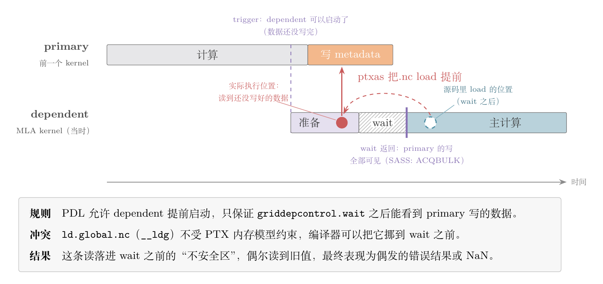
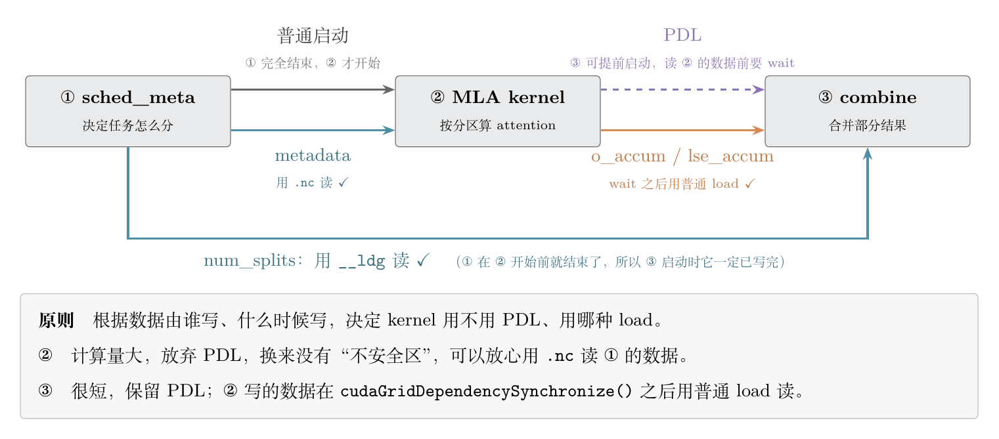
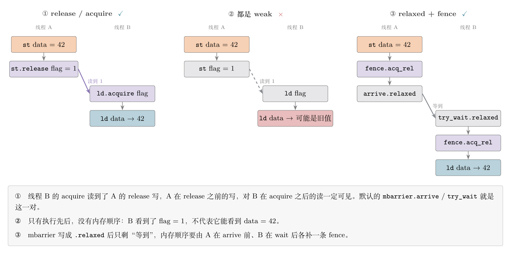
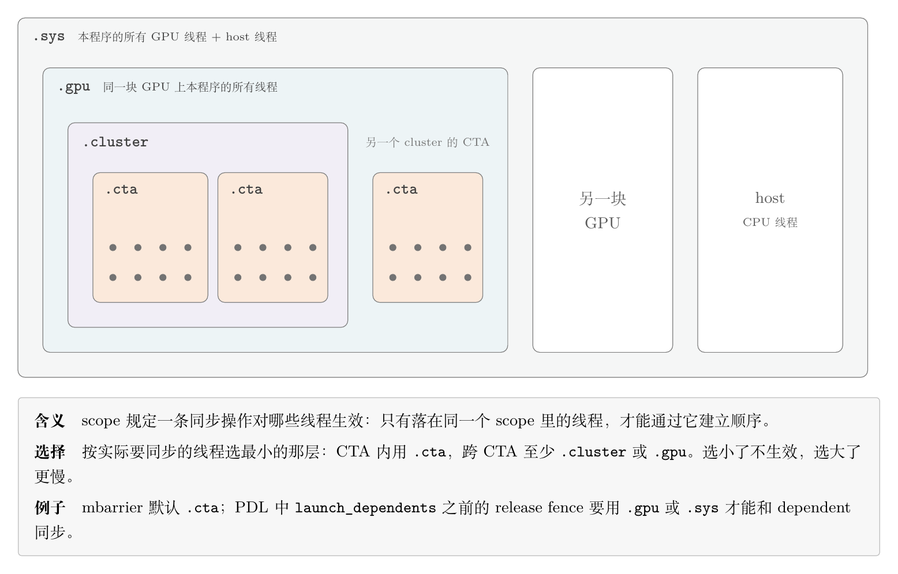
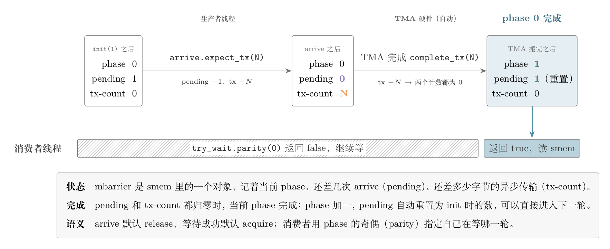
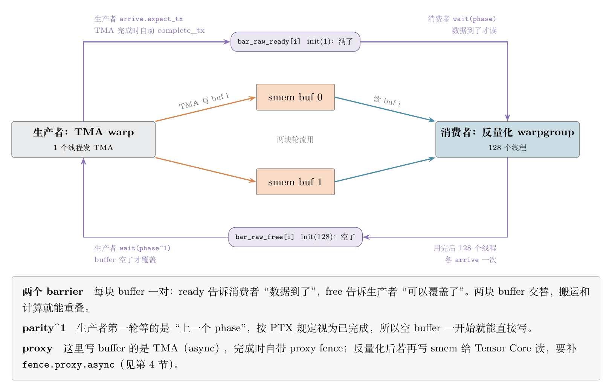
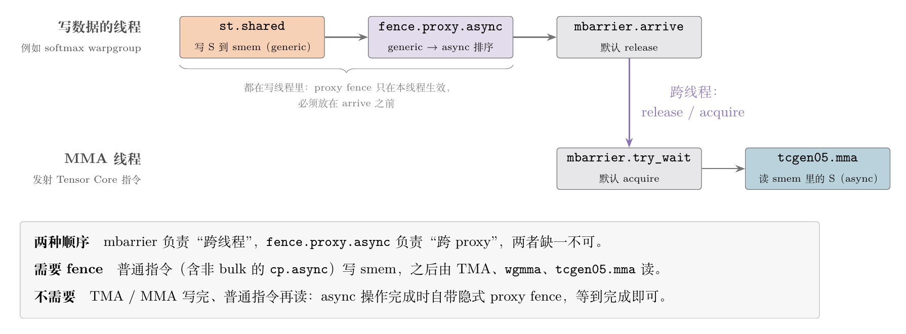
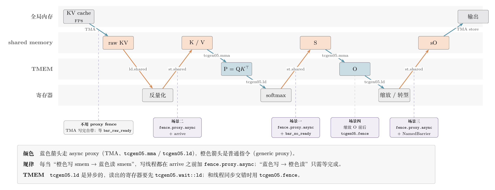

> 前置阅读：[FlashAttention：IO 感知的精确 Attention 计算](https://xuesongtap.github.io/2026/03/22/flash-attention.html) · [Blackwell TMEM 与 tcgen05 MMA 深度解析](https://xuesongtap.github.io/2026/05/19/blackwell-tmem-tcgen05-mma.html)
>
> 资料核对于 2026-11-10，对应 PTX ISA 9.5、FlashMLA 提交 `395cb3a`。标「推断」的是个人理解，文档和代码里没有直接写。

2025 年 4 月，FlashMLA 有一个只改了几行的提交，标题是 *Fix synchronization issues*。[1] 核心改动是把一个 `__ldg` 换成了普通的指针解引用：

```diff
     cudaGridDependencySynchronize();

     int *tile_scheduler_metadata_ptr = params.tile_scheduler_metadata_ptr + partition_idx * TileSchedulerMetaDataSize;
-    int4 tile_scheduler_metadata = __ldg(reinterpret_cast<int4 *>(tile_scheduler_metadata_ptr));
+    // We don't use __ldg here, otherwise NVCC (ptxas, in particular) will do instruction reorder
+    // and place __ldg (LDG.E.128.CONSTANT in SASS) in front of cudaGridDependencySynchronize()
+    // (ACQBULK in SASS), leading to data race.
+    int4 tile_scheduler_metadata = *(reinterpret_cast<int4 *>(tile_scheduler_metadata_ptr));
```

源码里，读操作明明写在同步之后。可编译出来的机器码里，它被挪到了同步前面，于是读到了还没写好的数据。

这不是编译器"写错了"。

按 PTX 的规定，`__ldg` 这条读**根本不受内存模型约束**，挪到哪里都合法。


## 0. 先验理解：程序顺序 ≠ 可见顺序

写 CUDA 时很容易默认"代码怎么写，机器就怎么执行；先写的数据，后面一定读得到"。实际上，有三个环节会打破这个直觉：

| 环节 | 它可能做什么 | 用什么约束它 |
|---|---|---|
| 编译器（nvcc 前端 / ptxas） | 只要它认为结果不变，就把 load 提前、把 store 推后 | 内存模型规定的顺序；不在模型内的访存不受约束 |
| 内存系统 | 一个线程的写，对另一个线程什么时候可见、以什么顺序可见，没有天然保证 | release / acquire、fence，外加 scope |
| proxy | 同一块内存，普通 `ld/st` 和 TMA、Tensor Core 走的是不同的访问路径，彼此不保证顺序 | `fence.proxy.async` |

另外还要区分两个经常被混在一起的概念：

- **执行顺序**：B 在 A **做完之后**才开始。barrier 的 arrive / wait 管的是这个。
- **内存顺序**：A **写的数据**对 B **可见**。这需要 release / acquire 语义或者 fence。


## 1. 第一层：不在内存模型里的访存——`ld.global.nc`

### 1.1 PTX 怎么说

`__ldg(ptr)` 编译成 PTX 的 `ld.global.nc`，SASS 里显示为 `LDG.E...CONSTANT`。PTX 对它的描述是"从全局内存读，并可选地缓存在 non-coherent 的只读缓存里"。[2]

关键的一句在内存模型那一章的开头：[3]

> The memory consistency model does not apply to texture (including `ld.global.nc`) and surface accesses.

也就是说，**`ld.global.nc` 不参与 PTX 内存模型**。

release / acquire、fence、barrier 建立的任何顺序，都不约束它。编译器可以认为它读的是一块"在 kernel 运行期间不会变"的数据，于是早读晚读都一样，可以随意调度。

PTX 9.4 新增了一个语义更明确的写法 `ld.proxy::readonly`，把这个前提直接写进了规范：[2]

> When this qualifier is specified, the memory location referred to by source operand `a` is treated as read-only during the lifetime of the kernel.

所以 `.nc` / readonly 的契约是：**在本 kernel 的整个生命周期里，这块数据不会被任何人写**。

在普通的 stream 语义下，这个契约很容易满足：同一个 stream 里，前一个 kernel 完全结束，后一个才开始，前一个写的数据在后一个运行期间确实不变。问题出在下面这个打破 stream 语义的机制上。

### 1.2 PDL：让后一个 kernel 提前开跑

PDL（Programmatic Dependent Launch）允许后一个 kernel（secondary / dependent）在前一个 kernel（primary）还没结束时就启动，好让 secondary 的准备工作（初始化 barrier、预取 TMA descriptor、分配 tensor memory）和 primary 的收尾重叠。

它在 PTX 里对应 `griddepcontrol`：[4]

- `griddepcontrol.launch_dependents`（CUDA 里是 `cudaTriggerProgrammaticLaunchCompletion()`）：所有 CTA 都发出这条指令或已经退出后，dependent 就可以被调度。原文还特意说明：**dependent 可能在当前 grid 结束之前启动**。
- `griddepcontrol.wait`（CUDA 里是 `cudaGridDependencySynchronize()`）：

  > causes the executing thread to wait until all prerequisite grids in flight have completed and all the memory operations from the prerequisite grids are performed and made visible to the current grid.

CUDA Programming Guide 说得更直白：secondary 的线程块"可能在 primary 写的数据可见之前就启动"；如果 primary 不调用 trigger，则在它所有线程块退出后隐式触发。[5]

由此得出两条规矩：

1. **trigger 不等于数据就绪**。它只表示 dependent 可以上 SM 了，primary 后面可能还在写数据。
2. 在 dependent 里，**`griddepcontrol.wait` 之前是不安全区**：primary 写的任何东西，这时候都可能还没写完。

### 1.3 两者相撞

把 1.1 和 1.2 放在一起：

- 开了 PDL，dependent **运行期间** primary 可能还在写，`.nc` 的"生命周期内只读"前提不成立了；
- 但 `.nc` 不在内存模型里，`griddepcontrol.wait` 约束不了它，ptxas 照样可以把它提前到 wait 前面。

FlashMLA 当时的情况正是这样：



图中蓝色虚线圆是源码里 load 的位置，在 wait 之后；

红点是 ptxas 实际排出来的位置，在 wait 之前。这时 primary 还在写 metadata，读到的就是旧值。


## 2. FlashMLA 现在的写法

FlashMLA 的 decode（开启 split-KV 时）在同一个 stream 上依次发出三个 kernel：① 决定任务怎么分，写 `tile_scheduler_metadata` 和 `num_splits`；② MLA kernel 按分区计算 attention，写部分结果 `o_accum` / `lse_accum`；③ combine 把部分结果合并成最终输出。[6][7]

它的处理原则是：**按数据是谁写的、什么时候写的，决定 kernel 用不用 PDL、用哪种 load**。



MLA kernel 的启动和读 metadata：[8][9]

```cpp
// NOTE Don't use PDL because of potential compiler bugs!
mla_kernel<<<dim3(params.s_q, ENABLE_SPLITKV ? params.num_sm_parts : params.b, 1),
             dim3(NUM_THREADS, 1, 1), smem_size, params.stream>>>(params, tma_params);

KU_LDG_256(params.tile_scheduler_metadata_ptr + partition_idx, &sched_meta,
           ".nc", "no_allocate", "evict_normal", "256B");   // 显式选择 .nc
```

它不做 dependent，也就没有"不安全区"，可以放心用 `.nc`。

它在结尾仍然调用 `cudaTriggerProgrammaticLaunchCompletion()`，让 combine 提前上 SM。[11]

combine kernel：[12]

```cpp
cudaGridDependencySynchronize();   // 等 MLA kernel 完成、写入可见
datas[i] = *(float4*)(oaccum_ptr + lane_idx*4 + i*128); // NOTE We don't use __ldg here since it is incompatible with PDL
```

一句话总结：**跑得重的 MLA kernel 放弃 PDL、保留 `.nc`；很短的 combine 保留 PDL，primary 写的数据在 wait 之后用普通 load 读。**

**推断**：combine 在 wait 之前用 `__ldg` 读 `num_splits` 是安全的，但这依赖"MLA kernel 不是 PDL dependent"。如果以后给 MLA kernel 开启 PDL，这里也要一起改。

## 3. 第二层：模型内部的顺序——release / acquire、scope、mbarrier

`.nc` 不在模型里，那么模型里的访存靠什么建立顺序？

### 3.1 strength：weak / relaxed / acquire / release

PTX 的 `ld` / `st` 默认是 `.weak`，没有任何同步效果，"只有通过其他手段建立同步后，它的效果才对其他线程可见"。[2] 要建立线程间的顺序，需要以下几种手段之一：

- **release 写 + acquire 读**：`st.release` / `ld.acquire`、`atom.release` 等。读到 release 写入的值之后，release 之前的所有写，对 acquire 之后的读都可见
- **fence**：`fence.acq_rel` 是"轻量级 fence，对大多数程序已经足够"，省略 `.sem` 时默认就是它；`fence.sc` 更慢，能恢复顺序一致性。[13] 在 sm_70 及以后，`membar` 就是 `fence.sc` 的同义词

三种常见写法对比如下（③ 会在 3.3 节用到）：



### 3.2 scope：和谁同步

每个带同步语义的操作都有一个 scope，表示它对哪些线程生效：[14]



warp 不是一个 scope。scope 选小了，同步对需要的线程不生效；选大了，性能变差。PDL 的 trigger 也和 scope 相关：`launch_dependents` 之前的 release fence，只有在 scope 为 `.gpu`（且同一个 memory synchronization domain）或 `.sys` 时，才与 dependent grid 的开始同步。[4]

### 3.3 mbarrier：自带 release / acquire 的计数器

Hopper 之后的 kernel 大量使用 `mbarrier`（shared memory 里的一个计数器）做生产者-消费者同步。它的默认语义是：[15][16]

- `mbarrier.arrive`："If the `.sem` qualifier is absent, `.release` is assumed by default."，scope 默认 `.cta`；
- `mbarrier.test_wait` / `try_wait`：默认 `.acquire`，scope 默认 `.cta`；
- 两者都可以显式写 `.relaxed`，此时"不提供任何内存顺序语义和可见性保证"。

所以默认的 arrive / wait 构成一对 release / acquire：生产者在 arrive 之前写的数据，消费者 wait 成功后就能看到。前提是**这些读写都走 generic proxy**。一旦消费者不是普通 `ld`，而是 TMA 或 Tensor Core，mbarrier 就不够了，这就是下一层的问题。

如果为了性能用 `.relaxed`，那么 mbarrier 只剩执行顺序，内存顺序要自己用 fence 补上，也就是 3.1 节图中的写法 ③。

mbarrier 本身怎么工作，可以看它的状态。PTX 规定，一个 mbarrier 记录当前 phase、本 phase 还差几次 arrive（pending arrival count）、还差多少异步传输（tx-count）；两个计数都归零时，当前 phase 完成，pending 自动重置为初始化时的数，进入下一个 phase。[28] 以"TMA 搬一块数据"为例：



tx-count 允许暂时为负，所以生产者先发 TMA、后 `arrive.expect_tx` 也没问题：pending 不归零，phase 就不会提前完成。FlashMLA 正是这个顺序。

实际 kernel 里，mbarrier 通常成对出现，组成多缓冲流水线。FlashMLA 的 decode kernel 用两块 buffer 存 KV，每块配一对 barrier：[29]



## 4. 第三层：proxy——同一块内存，不同的访问路径

### 4.1 什么是 proxy

PTX 的定义：[17]

> A memory proxy, or a proxy is an abstract label applied to a method of memory access. When two memory operations use distinct methods of memory access, they are said to be different proxies.
>
> A proxy fence is required to synchronize memory operations across different proxies.

除非特别说明，访存都走 **generic proxy**。走其他 proxy 的包括：texture / surface、`.async.bulk` 操作的 async proxy 和 tensormap proxy、readonly proxy 等。

和 kernel 编写最相关的是 generic 与 async 的划分：

| 操作 | proxy | 出处 |
|---|---|---|
| 普通 `ld` / `st`（包括 shared memory） | generic | [17] |
| `cp.async`（非 bulk，即 SASS 的 `LDGSTS`） | **generic**："`cp.async` is treated as a weak memory operation performed in the generic proxy" | [18] |
| `cp.async.bulk` / `cp.async.bulk.tensor`（TMA） | async | [19] |
| `wgmma.mma_async` | async | [20] |
| `tcgen05.mma` / `tcgen05.cp` 对 shared memory 的访问 | async | [21] |

非 bulk 的 `cp.async` 名字里带 async，但它走的是 generic proxy，这一点很容易搞错。

### 4.2 两个方向不对称

上面每一条 async 操作的文档里都有类似的话（以 TMA 为例）：[19]

> The completion of a `cp{.reduce}.async.bulk` operation is followed by an implicit generic-async proxy fence. So the result of the asynchronous operation is made visible to the generic proxy as soon as its completion is observed.

也就是说：

- **async 写 → generic 读**：async 操作完成时自带 proxy fence。等 mbarrier 或 wait_group 观察到它完成之后，普通 `ld` 就能读到结果，不用额外加 fence。
- **generic 写 → async 读**：**没有**隐式 fence，必须显式写 `fence.proxy.async`。

几个常见组合：

| 生产者 → 消费者 | 是否需要 `fence.proxy.async` |
|---|---|
| TMA load → `wgmma` / `tcgen05.mma` | 不需要：同属 async proxy，等 mbarrier 的 transaction 计数完成即可 |
| `cp.async`（LDGSTS）→ `wgmma` | **需要**：generic → async |
| 线程用 `st.shared` 写数据 → `wgmma` / `tcgen05.mma` | **需要** |
| 线程用 `st.shared` 写输出 → TMA store | **需要** |
| `wgmma` / TMA 结果 → 线程用 `ld` 读 | 不需要：完成时有隐式 fence |

### 4.3 fence 加在哪：生产者线程，barrier 之前

`fence.proxy.async` 这类双向 proxy fence 有一个容易忽略的性质：[13]

> Bi-directional proxy fences do not directly synchronize with other fences in the sense that fences with `.release` or `.acquire` semantics do. Instead, bi-directional proxy fences take effect within a single thread and therefore do not have a `.scope` qualifier.

它只在**本线程内**生效，不负责跨线程同步。所以正确的组合是"proxy fence 管跨 proxy，barrier 管跨线程"：由**写数据的线程**在写完之后、到达 barrier 之前执行 fence。以 `cp.async` 喂 `wgmma` 为例：

```
cp.async (LDGSTS)          // generic 写 smem
cp.async.commit_group
cp.async.wait_group 0      // 只保证"本线程发出的拷贝已完成"
fence.proxy.async.shared::cta   // 把这些 generic 写对 async proxy 排好序
bar.sync / mbarrier.arrive      // 跨线程：通知 MMA 线程
wgmma.mma_async / tcgen05.mma   // async 读 smem
```

`wait_group` 只说明数据已经到了 shared memory，不提供跨 proxy 的顺序。少了 fence，Tensor Core 有可能读到旧数据。

换成 FlashMLA 里"softmax 结果写 smem，交给 Tensor Core 做 P·V"的场景（见第 5 节），两种顺序各管一段：




## 5. 回到 FlashMLA：一个 kernel 里的几种同步

FlashMLA 的 SM100 decode kernel（`head64/kernel.cuh`）里，上面几层规则都能找到对应的写法。先看几个封装：

- `fence_view_async_shared()`（CUTLASS）就是 `fence.proxy.async.shared::cta`；[22]
- `fence_barrier_init()` 是 `fence.mbarrier_init.release.cluster`，保证 mbarrier 初始化对后续使用者可见；[22]
- `fence_view_async_tmem_load()` 是 `tcgen05.wait::ld.sync.aligned`，等 TMEM → 寄存器的异步 load 完成；[23]
- `ku::tcgen05_before_thread_sync()` / `after_thread_sync()` 是 `tcgen05.fence::before_thread_sync` / `after_thread_sync`。[10]

把一次 KV 块的处理按数据经过的存储位置画出来，四个场景分别落在下面这几处交接上：



**场景一：softmax 结果写 smem，交给 Tensor Core 做 P·V。** [24]

```cpp
// Write S
for (int i = 0; i < NUM_ELEMS_PER_THREAD/8; i += 1)
    *(uint128_t*)(sS_base + MMA_M*8*i) = *(uint128_t*)(s + i*4);   // generic 写 smem
...
fence_view_async_shared();                // generic → async
plan.bar_so_ready[rs.buf_idx].arrive();   // mbarrier release：通知 MMA warp
```

MMA warp 等到 `bar_so_ready` 后发出 `tcgen05.mma`，从 shared memory 读 S，这是 async proxy 读。顺序完全是 4.3 的模板：写 → proxy fence → arrive。

**场景二：KV 反量化。** [25] FP8 的 KV 先由 TMA 搬进 smem（async 写），反量化 warp 用普通指令读出来、反量化、再用普通指令写回 smem（generic 写），最后交给 Tensor Core（async 读）：

```cpp
dequant->run(raw, raw + F::QUANT_BYTES, rs.buf_idx == 0 ? dst_0 : dst_1, []{});
cutlass::arch::fence_view_async_shared();
plan.bar_quant_part_dequant_ready[rs.buf_idx].arrive();
plan.bar_raw_free[rs.buf_idx].arrive();
```

读 TMA 结果时没有加 fence（完成时隐式 fence，靠 `bar_raw_ready` 观察完成），写回给 MMA 用之前加了 fence。两个方向的不对称在这里都体现了。

**场景三：epilogue，TMEM → 寄存器 → smem → TMA store。** [26]

```cpp
ku::tmem_ld_32dp32bNx<B_EPI>(tmem_cols::O + i*B_EPI, o);
cutlass::arch::fence_view_async_tmem_load();       // 等 tcgen05.ld 完成，寄存器才能用
... 缩放、转 bf16 ...
*(__int128_t*)(sO_bases[j] + col_base*MMA_M) = ...;   // generic 写 smem
fence_view_async_shared();                          // generic → async
NamedBarrier::arrive_and_wait(128, NamedBarriers::wg0_sync);   // 跨线程
if (warp_idx < O_FOLD && elect_one_sync())
    cute::copy(tma_params.tma_O, ...);              // TMA store：async 读 smem
```

**场景四：tcgen05 操作与线程同步之间的 fence。** [24] 修改 TMEM 中 O 的缩放前后：

```cpp
ku::tcgen05_after_thread_sync();
rescale_O<...>(scale_for_old);
ku::tcgen05_before_thread_sync();
```

PTX 对这对 fence 的描述是：它们和执行顺序指令（barrier 等）组合，为 tcgen05 指令提供跨线程的顺序；同时也是"代码移动屏障"，tcgen05 指令不能被提升越过它们。[27] 这和第 1 节的问题是同一类：**同步点要阻止编译器把特定指令挪过去，必须有语义上的约束，不能只靠源码顺序。**

## 参考

[1] FlashMLA 提交 `01a2772`（2025-04-28），*Fix synchronization issues*. <https://github.com/deepseek-ai/FlashMLA/commit/01a27728e664377097d39b1ad9fc68cd6f570fc5>

[2] NVIDIA, *PTX ISA 9.5*, Data Movement and Conversion Instructions: `ld`（含 `.weak`、`.proxy::readonly`）与 `ld.global.nc`. <https://docs.nvidia.com/cuda/parallel-thread-execution/index.html#data-movement-and-conversion-instructions-ld>

[3] NVIDIA, *PTX ISA 9.5*, §8.1 Scope and applicability of the model. <https://docs.nvidia.com/cuda/parallel-thread-execution/index.html#scope-and-applicability>

[4] NVIDIA, *PTX ISA 9.5*, Parallel Synchronization and Communication Instructions: `griddepcontrol`. <https://docs.nvidia.com/cuda/parallel-thread-execution/index.html#parallel-synchronization-and-communication-instructions-griddepcontrol>

[5] NVIDIA, *CUDA Programming Guide*, Programmatic Dependent Launch — API Description. <https://docs.nvidia.com/cuda/cuda-programming-guide/04-special-topics/programmatic-dependent-launch.html#api-description>

[6] FlashMLA, `csrc/api/sparse_decode.cpp`，三个 kernel 的发起顺序. <https://github.com/deepseek-ai/FlashMLA/blob/395cb3afbb331fef7b1b21e9340861b9436b42d8/csrc/api/sparse_decode.cpp#L380-L436>

[7] FlashMLA, `DecodingSchedMeta`，`csrc/params.h`；生成逻辑见 `csrc/cuda_kernels/smxx/decode/get_decoding_sched_meta/get_decoding_sched_meta.cu`. <https://github.com/deepseek-ai/FlashMLA/blob/395cb3afbb331fef7b1b21e9340861b9436b42d8/csrc/params.h#L86-L94> · <https://github.com/deepseek-ai/FlashMLA/blob/395cb3afbb331fef7b1b21e9340861b9436b42d8/csrc/cuda_kernels/smxx/decode/get_decoding_sched_meta/get_decoding_sched_meta.cu>

[8] FlashMLA, SM100 sparse decode kernel 启动，`csrc/cuda_kernels/sm100/decode/sparse/head64/kernel.cuh`. <https://github.com/deepseek-ai/FlashMLA/blob/395cb3afbb331fef7b1b21e9340861b9436b42d8/csrc/cuda_kernels/sm100/decode/sparse/head64/kernel.cuh#L732-L733>

[9] FlashMLA, 读取 scheduler metadata，同上文件. <https://github.com/deepseek-ai/FlashMLA/blob/395cb3afbb331fef7b1b21e9340861b9436b42d8/csrc/cuda_kernels/sm100/decode/sparse/head64/kernel.cuh#L98-L130>

[10] FlashMLA, kerutils `KU_LDG_256` 与 `tcgen05_before/after_thread_sync`，`csrc/3rdparty/kerutils/include/kerutils/device/cuda/sm100/intrinsics.cuh`. <https://github.com/deepseek-ai/FlashMLA/blob/395cb3afbb331fef7b1b21e9340861b9436b42d8/csrc/3rdparty/kerutils/include/kerutils/device/cuda/sm100/intrinsics.cuh#L178-L198> · <https://github.com/deepseek-ai/FlashMLA/blob/395cb3afbb331fef7b1b21e9340861b9436b42d8/csrc/3rdparty/kerutils/include/kerutils/device/cuda/sm100/intrinsics.cuh#L262-L271>

[11] FlashMLA, MLA kernel 中的 trigger. <https://github.com/deepseek-ai/FlashMLA/blob/395cb3afbb331fef7b1b21e9340861b9436b42d8/csrc/cuda_kernels/sm100/decode/sparse/head64/kernel.cuh#L308-L314>

[12] FlashMLA, combine kernel，`csrc/cuda_kernels/smxx/decode/combine/combine.cu`. <https://github.com/deepseek-ai/FlashMLA/blob/395cb3afbb331fef7b1b21e9340861b9436b42d8/csrc/cuda_kernels/smxx/decode/combine/combine.cu#L64-L98> · <https://github.com/deepseek-ai/FlashMLA/blob/395cb3afbb331fef7b1b21e9340861b9436b42d8/csrc/cuda_kernels/smxx/decode/combine/combine.cu#L216-L229>

[13] NVIDIA, *PTX ISA 9.5*, Parallel Synchronization and Communication Instructions: `membar` / `fence`. <https://docs.nvidia.com/cuda/parallel-thread-execution/index.html#parallel-synchronization-and-communication-instructions-membar>

[14] NVIDIA, *PTX ISA 9.5*, §8.5 Scope. <https://docs.nvidia.com/cuda/parallel-thread-execution/index.html#scope>

[15] NVIDIA, *PTX ISA 9.5*, `mbarrier.arrive`. <https://docs.nvidia.com/cuda/parallel-thread-execution/index.html#parallel-synchronization-and-communication-instructions-mbarrier-arrive>

[16] NVIDIA, *PTX ISA 9.5*, `mbarrier.test_wait` / `mbarrier.try_wait`. <https://docs.nvidia.com/cuda/parallel-thread-execution/index.html#parallel-synchronization-and-communication-instructions-mbarrier-test-wait-try-wait>

[17] NVIDIA, *PTX ISA 9.5*, §8.6 Proxies. <https://docs.nvidia.com/cuda/parallel-thread-execution/index.html#proxies>

[18] NVIDIA, *PTX ISA 9.5*, Data Movement and Conversion Instructions: Non-bulk copy（`cp.async`）. <https://docs.nvidia.com/cuda/parallel-thread-execution/index.html#data-movement-and-conversion-instructions-non-bulk-copy>

[19] NVIDIA, *PTX ISA 9.5*, `cp.async.bulk` 的 async proxy 说明. <https://docs.nvidia.com/cuda/parallel-thread-execution/index.html#async-proxy>

[20] NVIDIA, *PTX ISA 9.5*, Asynchronous Warpgroup Level Matrix: Async Proxy. <https://docs.nvidia.com/cuda/parallel-thread-execution/index.html#asynchronous-warpgroup-level-matrix-async-proxy>

[21] NVIDIA, *PTX ISA 9.5*, tcgen05 Memory Consistency Model: Shared Memory Accesses. <https://docs.nvidia.com/cuda/parallel-thread-execution/index.html#tcgen05-memory-consistency-model-smem-access>

[22] NVIDIA CUTLASS, `fence_view_async_shared` 与 `fence_barrier_init`，`include/cutlass/arch/barrier.h`. <https://github.com/NVIDIA/cutlass/blob/main/include/cutlass/arch/barrier.h>

[23] NVIDIA CUTLASS, `fence_view_async_tmem_load`，`include/cute/arch/copy_sm100.hpp`. <https://github.com/NVIDIA/cutlass/blob/main/include/cute/arch/copy_sm100.hpp>

[24] FlashMLA, softmax 结果写 smem 与 O 缩放. <https://github.com/deepseek-ai/FlashMLA/blob/395cb3afbb331fef7b1b21e9340861b9436b42d8/csrc/cuda_kernels/sm100/decode/sparse/head64/kernel.cuh#L255-L275>

[25] FlashMLA, KV 反量化. <https://github.com/deepseek-ai/FlashMLA/blob/395cb3afbb331fef7b1b21e9340861b9436b42d8/csrc/cuda_kernels/sm100/decode/sparse/head64/kernel.cuh#L636-L653>

[26] FlashMLA, epilogue（TMEM → smem → TMA store）. <https://github.com/deepseek-ai/FlashMLA/blob/395cb3afbb331fef7b1b21e9340861b9436b42d8/csrc/cuda_kernels/sm100/decode/sparse/head64/kernel.cuh#L330-L360>

[27] NVIDIA, *PTX ISA 9.5*, tcgen05 Special Synchronization Operations: `tcgen05.fence`. <https://docs.nvidia.com/cuda/parallel-thread-execution/index.html#tcgen05-special-sync-operations-fence>

[28] NVIDIA, *PTX ISA 9.5*, Contents / Phase Completion of the mbarrier object. <https://docs.nvidia.com/cuda/parallel-thread-execution/index.html#parallel-synchronization-and-communication-instructions-mbarrier-contents> · <https://docs.nvidia.com/cuda/parallel-thread-execution/index.html#parallel-synchronization-and-communication-instructions-mbarrier-phase-completion>

[29] FlashMLA, KV 的 TMA 生产者与反量化消费者，`csrc/cuda_kernels/sm100/decode/sparse/head64/kernel.cuh`. <https://github.com/deepseek-ai/FlashMLA/blob/395cb3afbb331fef7b1b21e9340861b9436b42d8/csrc/cuda_kernels/sm100/decode/sparse/head64/kernel.cuh#L505-L531> · <https://github.com/deepseek-ai/FlashMLA/blob/395cb3afbb331fef7b1b21e9340861b9436b42d8/csrc/cuda_kernels/sm100/decode/sparse/head64/kernel.cuh#L636-L653>
