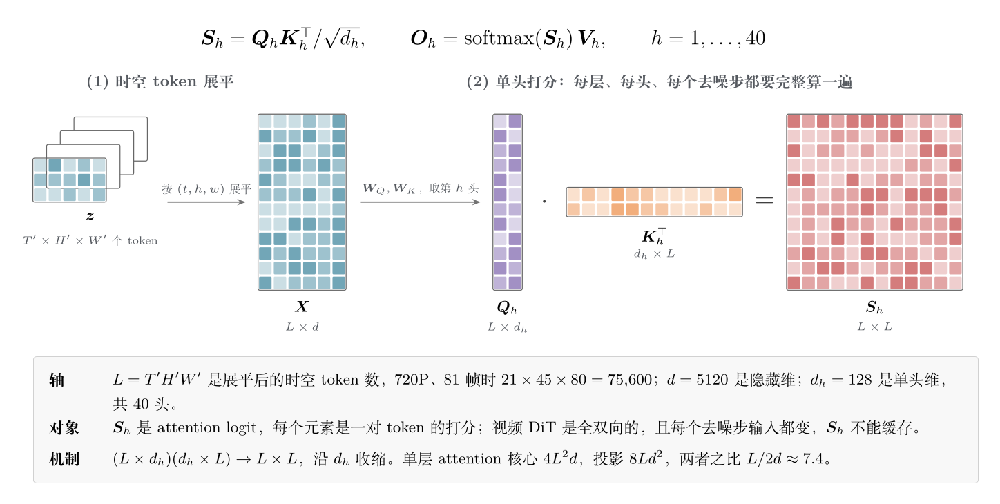
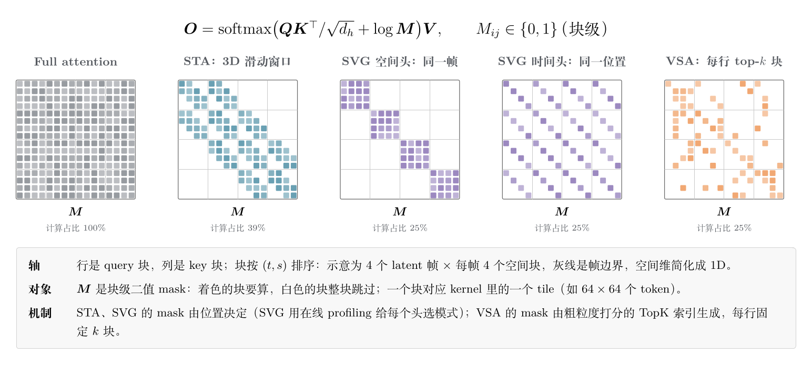
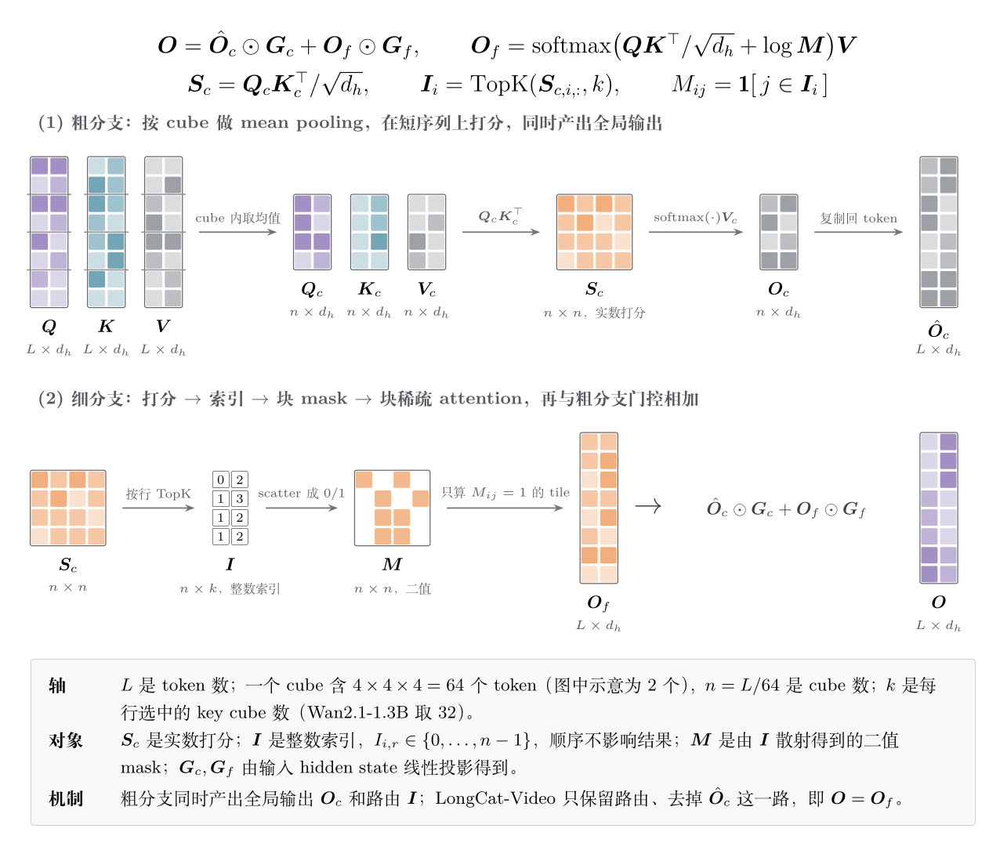
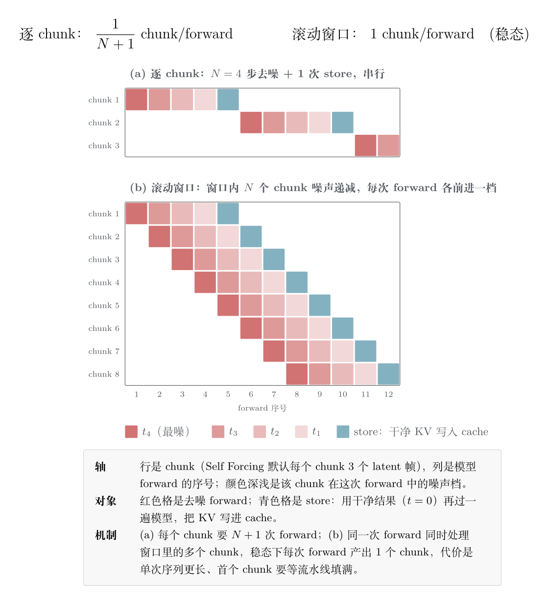

> 前置阅读：[稀疏注意力为什么收敛到 DSA](https://xuesongtap.github.io/2026/11/10/dsa-token-sparse.html) · [Fast-WAM：Wan 预训练怎样变成动作策略](https://xuesongtap.github.io/2026/09/30/fast-wam-wan-action-architecture.html)
>
> 资料核对于 2026-11-10。标「推断」的是个人理解，没有论文或实测支撑。


---

## 1. 视频 DiT 的 attention 为什么慢

### 1.1 超长上下文：一段视频就是 ~76k token

Wan2.1 的 VAE 压缩比是 4×8×8（时间×高×宽），DiT 的 patchify 再压 1×2×2。81 帧视频的 latent 帧数是 $(81-1)/4+1=21$。两档分辨率下的序列长度：

| 分辨率 | latent | token 数 $L$ |
|---|---|---|
| 480P（832×480） | 21 × 60 × 104 | 21 × 30 × 52 = **32,760** |
| 720P（1280×720） | 21 × 90 × 160 | 21 × 45 × 80 = **75,600** |

作为对比，LLM 的 76k token 已经算长上下文了，而视频只要 5 秒 720P 就有这么多。

### 1.2 FLOPs 拆分：720P 下 attention 占七成

Wan2.1 14B 的配置（`wan/configs/wan_t2v_14B.py`）：`dim=5120`，`ffn_dim=13824`，40 层，40 个 head（head_dim 128），`vae_stride=(4,8,8)`，`patch_size=(1,2,2)`。FFN 是 `Linear → GELU(tanh) → Linear` 两层 MLP（`wan/modules/model.py`），文本走 cross-attention（umT5，`text_len=512`）。单层 forward 的 FLOPs（乘加算 2）：

$$
\begin{aligned}
\text{Self-Attn 核心}\;(QK^\top,\ PV) &: 4L^2d \\
\text{Self-Attn 投影}\;(Q,K,V,O) &: 8Ld^2 \\
\text{Cross-Attn}\;(Q,O\text{ 投影 + 文本 }K,V) &: \approx 4Ld^2 \\
\text{FFN} &: 4Ld\,d_{\text{ffn}}
\end{aligned}
$$

前两项之比是 $4L^2d : 8Ld^2 = L : 2d$。只要 $L > 2d = 10240$，attention 核心就比投影贵，而视频的 $L$ 是它的 3 到 7 倍。代入数字：

| 分辨率 | attention 核心 | 其余线性层 | attention 占比 | 单次 forward（40 层） |
|---|---|---|---|---|
| 480P | 2.2×10¹³ | 2.0×10¹³ | **52%** | ≈ 1.7 PFLOPs |
| 720P | 1.17×10¹⁴ | 4.6×10¹³ | **72%** | ≈ 6.5 PFLOPs |

分辨率从 480P 升到 720P，token 数变成 2.3 倍，attention 的计算量变成 5.3 倍。**越往高分辨率、长视频走，attention 越是绝对的瓶颈。**



### 1.3 乘上步数和 CFG：每一步都重新 prefill

LLM 推理时，prefill 只做一次，之后靠 KV cache 逐 token decode。视频 DiT 做不到：

- **全双向 attention**：每个 token 都看所有 token，没有因果结构；
- **每一步的输入都变了**：去噪第 $k$ 步的 latent 和第 $k+1$ 步不同，K/V 不能复用；
- **步数 × CFG**：Wan2.1 `generate.py` 里 T2V 默认 50 步（I2V 40 步），`sample_guide_scale=5.0`；CFG 每步要分别跑条件和无条件两次 forward。

所以一段 720P 视频的总计算量约为：

$$
6.5\ \text{PFLOPs} \times 50\ \text{步} \times 2\ (\text{CFG}) \approx 650\ \text{PFLOPs}
$$

按 H100 BF16 稠密算力约 990 TFLOPS、MFU 50% 粗估，单卡要 20 分钟以上（推断，量级估算）。相当于把一个 76k token 的 prefill 连续做 100 遍。

### 1.4 为什么换个更快的 kernel 不够

FlashAttention 已经让 attention 变成 compute-bound，kernel 层面剩下的空间主要是 FA3/FA4 的硬件利用率，以及低精度（第 3.3 节）。真正能拉开数量级差距的是**少算**，方向有三个：

- 少算 attention 里的元素 → **稀疏**（第 2 节）；
- 少算步数 → **蒸馏**（第 3.1 节）；
- 少算重复的步 → **缓存**（第 3.2 节）。

---

## 2. 视频 DiT 的稀疏注意力现在怎么做

### 2.1 视频 attention 天然稀疏，稀疏结构有三个来源

**① 时空局部性。** STA [2] 在 HunyuanVideo 上统计发现，平均只占全部 token 15.52% 的局部窗口，就贡献了 70% 的 attention score。

**② 能量随距离衰减。** Radial Attention [3] 观察到，softmax 后的 attention 权重随 token 之间的时空距离增大而衰减，时间方向越远，需要关注的空间范围越小。

**③ head 特化。** Sparse VideoGen [4] 发现 head 大致分两类：**空间 head** 主要看同一帧内的 token，**时间 head** 主要看不同帧中同一位置的 token。实践中还能看到分工更细的 head，有的几乎只看 sink token，有的只看局部窗口。这一点对后面「能不能压 KV head」很关键。SVG 的做法是：每层每步随机抽 1% 的 query 行，分别算 full attention 和两种稀疏模式，选误差小的那种，profiling 精度和抽 100% 几乎一样（PSNR 31.12 vs 31.32）；端到端加速在 CogVideoX-v1.5 上是 2.28 倍，HunyuanVideo 上 1.92 倍（叠加 FP8 是 2.33 倍），Wan2.1 上 1.51 倍 [4]。

这三种结构的稳定程度不同：①、② 比较固定，可以写成静态 mask；③ 随 prompt、层、去噪步变化，需要动态判断。现有方案大致按这个分界来分类。

### 2.2 方案分类

| 类别 | 代表 | 是否需要训练 | 稀疏模式 | 主要取舍 |
|---|---|---|---|---|
| 静态窗口 | STA [2]、Radial [3] | 免训练可用，微调更好 | 固定 3D 窗口 / 随时间收缩的窗口 | 实现简单、kernel 高效；但长程依赖靠多层堆叠，可能漏掉远处的关键 token |
| 免训练动态 | Sparse VideoGen [4]、SpargeAttn [5] | 否 | 在线采样 profiling，或先粗算再选块 | 即插即用；稀疏度上限不高，SLA 论文统计序列短于 50K 时一般只有 40%–60% [8]，端到端加速多在 1.5 到 2.3 倍 |
| 可训练块稀疏 | VSA [6]、LongCat-Video [7] | 是 | 粗粒度打分后选 top-k 块 | 能做到 90% 以上稀疏且基本不掉质量；需要训练或继续训练 |
| 稀疏 + 线性混合 | SLA [8] | 微调 | 大权重走稀疏，中等权重走线性，小权重丢弃 | 稀疏度最高；效果依赖 backbone，实践中有争议 |
| 全线性 | SANA-Video [9] | 从头训练 | 线性注意力 + 块级自回归 | O(N)，有恒定大小的状态；质量上限是主要问题 |



图中按 4 帧 × 每帧 4 个空间块示意。STA、SVG 的 mask 只和位置有关；VSA 每行选哪 $k$ 块由内容决定，每个 query 块选的都不一样。

### 2.3 静态窗口：STA 与 Radial

逐 token 的 sliding window 在 GPU 上很慢：每个 query 对应的窗口不同，mask 不规则，FlashAttention 的 tile 里一半是被 mask 掉的空算。

**STA [2] 的做法是让窗口按 tile 滑动，而不是按 token 滑动**：先把 token 重排，让每个 3D cube（大小对齐 FlashAttention 的 block）在内存里连续；窗口以 cube 为单位滑动。这样每个 tile 要么全算、要么全跳，没有半空的 tile。论文报告 attention 比 FA3 快 1.6 到 10 倍。

**Radial [3]** 在此基础上让时间维的窗口指数收缩，复杂度降到 $O(n\log n)$，配合 LoRA 微调可以把生成长度拉长到 4 倍。

### 2.4 可训练块稀疏：VSA 与 LongCat

**VSA [6]** 是目前最完整的可训练方案，分两路：

- **粗分支（compressed branch）**：按 4×4×4 的 cube 做 mean pooling，在压缩后的短序列上算一遍 attention。这一路有两个作用：输出本身作为全局的粗粒度信息；打分结果给每个 query cube 选出 top-k 个 key cube；
- **细分支**：只在选中的 cube 里做 token 级 attention，块布局对齐稀疏 kernel；
- 两路输出用门控相加：$\mathbf O = \mathbf O_c \odot \mathbf G_c + \mathbf O_f \odot \mathbf G_f$，门控向量 $\mathbf G_c,\mathbf G_f$ 由输入 hidden state 经线性投影得到。

默认 cube 是 4×4×4，即 tile 大小 64 个 token；top-k 是在 cube 级 attention 矩阵上按行选的。加装到 Wan2.1-1.3B 时取 $\mathcal K=32$，对应 91.2% 稀疏度，14B 用 90% 稀疏度。消融实验里，mean pooling 比 max pooling 和卷积 pooling 都好 [6]。



论文报告：从头预训练时，训练 FLOPs 降 2.53 倍，loss 不变；加装到 Wan2.1 上，attention 快 6 倍，端到端从 31s 降到 18s [6]。

**LongCat-Video [7]** 可以看作「VSA 去掉粗分支的输出」：同样把 Q/K 切成 3D block、用 block 均值打分、取 top-r，但均值只用来**路由**，不作为一路输出。报告称 attention 计算量降到 dense 的 10% 以下，并实现了 ring 版本来兼容 context parallel。

**训练和推理用不同的稀疏度**：VSA 论文的稀疏适配是让 $\mathcal K$ 从 full attention 逐步降到目标值，并提到「更大的 $\mathcal K$ 能降低训练 loss，但推理更贵」，把这个取舍留给了后续工作 [6]。工程上有一种做法是反过来利用这一点：训练时用更高的稀疏度（$\mathcal K$ 更小）省算力，推理时用更低的稀疏度（$\mathcal K$ 更大）补回质量。我没查到公开论文对这种做法的系统对比，暂时算作工程经验。

### 2.5 稀疏 + 线性 与 全线性

**SLA [8]** 把 attention 权重分成三档：大权重做精确的稀疏 attention，中等权重用线性 attention 近似，小权重直接丢掉。论文报告在 Wan2.1-1.3B 上 attention 计算减少 95%，端到端快 2.2 倍。

**SANA-Video [9]** 走得更远：把所有 attention 换成线性 attention，用线性注意力的累积状态替代 KV cache，做块级自回归的长视频生成。它的流式版本是 attn sink + 滑动窗口 + 线性注意力（GDN 类）的混合。

对这条路线有两个常见的质疑：

- **同类机制叠了两遍**：attn sink + 滑动窗口和线性注意力都属于「近处精确、远处模糊」这一类，叠在一起是冗余的。更合理的分工是借鉴 LLM 的混合架构：**稀疏 attention 做精确检索 + 线性 attention（如 Gated DeltaNet [10]）做模糊记忆**；
- **双流是妥协**：在 softmax 层旁边**并联**一个线性分支，可以直接在已有模型上微调；而像 LLM 那样按层**串联**（比如每 3 层线性配 1 层 full），基本要求从头预训练。视频模型的预训练太贵，所以大家先选了并联。

### 2.6 实现层面的约束

无论哪种方案，想要真正变快，都绕不开这几条：

1. **块对齐**：稀疏的粒度必须是 kernel 的 tile，比如 64 或 128 个 token，逐 token 的稀疏省不下钱；
2. **3D 重排**：token 默认按 `(t, h, w)` 光栅顺序展平，3D cube 在内存里不连续。STA 和 VSA 都需要先把 cube 重排成连续布局，算完再排回去；
3. **形状约束**：VSA 固定 4×4×4 的 cube，要求 latent 的三个维度都能被 4 整除 [6]，分辨率选择因此受限；
4. **和并行策略兼容**：序列切到多卡后，选块的结果跨卡，Ulysses 和 Ring 需要各自适配，LongCat 专门做了 ring block sparse [7]。

### 2.7 还没解决的问题

- **对 backbone 敏感**：块稀疏在 Wan 这类单流结构（视觉 self-attn + 文本 cross-attn）上效果好，但有实践反馈在 MMDiT（SD3 [11] 提出的文本、视觉 joint attention 双流结构）上几乎没有收益。推断：joint attention 里大量是 text↔video 的交互，按视觉 3D 邻域切块的路由覆盖不到这部分。
- **GQA / MLA / DSA 还没进入视频**：主流开源视频 DiT 仍然是 MHA。DSA 那种 token 级稀疏需要 indexer 给每个 query 的所有 key 打分，在 76k token 的双向 attention 上，每一步都要重新打分，索引和存储开销都被放大。流式生成需要常驻的 KV cache，因此 MLA 更有吸引力；但第 2.1 节提到的 head 特化让人担心：强行压 KV head 数，可能会破坏那些「只看 sink」「只看局部」的专门化 head。

---

## 3. 推理还有哪些 trick

稀疏减少的是**每次 forward 的成本**。另外几个维度可以和它相乘：

$$
T_{\text{总}} = \underbrace{N_{\text{steps}}}_{\text{蒸馏}} \times \underbrace{C_{\text{CFG}}}_{\text{CFG 蒸馏}} \times \underbrace{(1-r_{\text{cache}})}_{\text{跨步缓存}} \times \underbrace{t_{\text{forward}}}_{\text{稀疏 / 量化}} \;/\; \underbrace{P}_{\text{并行}}
$$

### 3.1 少步蒸馏：50 步 → 4 步

收益最大的一项。DMD / DMD2 [12] 这类分布匹配蒸馏，可以把 50 步的教师模型压成 4 步左右的学生模型，同时把 CFG 蒸进去（CFG=1，每步只跑一次 forward）。合起来是 $50\times2 \to 4\times1$，约 25 倍。

社区最常见的形态是 lightx2v 的 4 步 LoRA：挂上 LoRA 后设 `steps=4, cfg=1`。代价是多样性和运动幅度通常会下降。

### 3.2 跨步缓存：相邻步的输出很像

相邻去噪步的中间特征变化很小，可以直接复用：

- **PAB [13]**：相邻步之间 attention 输出的差异随去噪进程呈 U 形，两头大、中间小。PAB 在中间段把 attention 输出直接广播给后续几步，并根据各类 attention 的方差给它们分配不同的广播间隔，形成金字塔结构。免训练，论文报告最多快 10.5 倍；
- **TeaCache [14]**：用经过 timestep embedding 调制的输入，估计这一步的输出会变多少；变化小于阈值就跳过整个 forward，直接复用上一步的残差。论文报告最多快 4.41 倍，VBench 只降 0.07%。

缓存和少步蒸馏是**互斥**的：4 步模型每一步变化都很大，没有可以缓存的东西。

### 3.3 量化

- **SageAttention [15]**：Q、K 按 block 量化到 INT8。量化前先对 K 减去所有 token 的均值，去掉通道上的共同偏置，也就去掉了离群值；这一步不改变 softmax 结果，因为每行 score 只差一个常数。$\tilde PV$ 保留 FP16，并且用 FP16 累加器，在 4090 上比 FP32 累加快约 2 倍且不掉精度。整体吞吐约为 FlashAttention2 的 2.1 倍，即插即用。后续版本支持 INT4 和 FP4 [16]；
- 权重用 FP8 或 NVFP4。SANA-Video 报告在 RTX 5090 上用 NVFP4 再快 2.4 倍 [9]。

### 3.4 多卡并行

单段视频的序列并行是标配。Wan 官方脚本直接支持 Ulysses 和 FSDP：

- **Ulysses [17]**：用 all-to-all 把序列维的切分换成 head 维的切分。`generate.py` 里有两条断言：`ulysses_size × ring_size` 必须等于总卡数，`num_heads` 必须能被 `ulysses_size` 整除（Wan 14B 有 40 个 head，可以用 8，不能用 16）；
- **Ring / USP [18]**：USP 把 Ulysses 和 Ring 组合起来，突破 head 数对并行度的限制；
- **CFG 并行**：条件和无条件两路 forward 放到不同的卡上，xDiT [19] 把它和序列并行、PipeFusion 统一到一个框架里。

### 3.5 流式生成：从「生成一段」到「实时一直生成」

前面几项都是让**一段**视频更快生成。数字人、交互式 world model 要的是另一件事：**低延迟、无限长、边生成边播放**。

**① 改成因果、按 chunk 自回归。** CausVid [20] → Self Forcing [21] → Rolling Forcing [22] 这条线，把双向的 Wan 蒸馏成因果、少步的生成器。视频按 chunk 生成，chunk 内部去噪 4 步左右，chunk 之间通过 KV cache 传递历史。这样一来，视频 DiT 又有了 KV cache，第 1.3 节说的「每一步都重新 prefill」变成了 LLM 那样的增量计算。

- Self Forcing [21] 在训练时就让模型基于自己生成的历史做 rollout，解决训练和推理时历史分布不一致的问题，单张 4090 能实时生成；
- Rolling Forcing [22] 不再逐 chunk 去噪，而是对一个**滑动窗口**里的多个 chunk 同时去噪，噪声水平逐个递增，再加 attention sink 保持长程一致。论文报告单卡 16 fps，能生成几分钟长的视频。

**② 每个 chunk 多一次 store forward。** chunk 去噪完以后，要把干净的结果（t=0）再过一遍模型，把这次的 KV 写入 cache，后续 chunk 才能看到干净的历史 [21]。Self Forcing 默认配置是每个 chunk 3 个 latent 帧，`denoising_step_list` 是 4 个时间步（从 1000 开始）；推理代码 `pipeline/causal_inference.py` 在 4 步去噪之后，还有这样一段：

```python
# Step 3.3: rerun with timestep zero to update KV cache using clean context
context_timestep = torch.ones_like(timestep) * self.args.context_noise
self.generator(noisy_image_or_video=denoised_pred, timestep=context_timestep,
               kv_cache=self.kv_cache1, ...)
```

所以每个 chunk 的 forward 次数是：

$$
F_{\text{chunk}} = N_{\text{steps}} + 1
$$

4 步模型实际跑 5 次 forward；1 步模型也要跑 2 次。

**③ 带噪流水线：把节拍压到每 chunk 1 次 forward。** 推断（基于 Rolling Forcing 的窗口设计）：窗口里同时有 $N$ 个 chunk，噪声水平依次为 $t_1>\dots>t_N$。每做一次 forward，所有 chunk 各前进一个噪声档：最老的 chunk 变干净、出窗，它的干净 KV 在下一次 forward 时顺带写入 cache；新 chunk 以纯噪声入窗。稳态吞吐就是：

$$
1\ \text{chunk}/\text{forward}
$$

这比纯 1 步模型（每 chunk 2 次 forward）还快。代价是单次 forward 的序列变长（整个窗口），首个 chunk 要等流水线填满才能出来。



**④ chunk 间的异步 context parallel。** 把不同 chunk 放到不同的卡上，每个 chunk 每算完一层就立刻把这一层的 KV 发给后面的 chunk，不等全局同步。有从业者把这种做法叫 Wave Parallel，下面是我的形式化（推断）：

chunk $i$ 单层 forward 的耗时记为 $\tau_i$。chunk $i$ 的上下文包含它之前的所有 chunk，越新的 chunk 上下文越长，所以 $\tau_i \le \tau_{i+1}$。chunk $i+1$ 算第 $l$ 层时，需要 chunk $i$ 第 $l$ 层的 KV。设两者的启动时间分别是 $S_i$、$S_{i+1}$，单层 KV 的传输时间是 $c$，不用等待的条件是：

$$
S_i + l\,\tau_i + c \;\le\; S_{i+1} + (l-1)\,\tau_{i+1},\quad \forall l
$$

因为 $\tau_{i+1}-\tau_i\ge0$，右边减左边随 $l$ 单调不减，只要 $l=1$ 时成立即可：

$$
S_{i+1}-S_i \;\ge\; \tau_i + c
$$

也就是说，后一个 chunk 只要比前一个晚启动「一层计算 + 一次传输」的时间，之后每层的 KV 都会提前到达，通信完全被计算盖住。模型这边的前提是依赖图里没有反向边：旧 chunk 不能读新 chunk 的任何东西。

这个方案和 Ulysses / USP 是正交的：USP 在 chunk **内部**切序列，异步 CP 在 chunk **之间**做流水，可以叠加使用。据从业者反馈，小模型上能跑到 150 fps，远超实时需要的 16 fps；但到 14B 附近通信开始藏不住。推断原因：大模型要切 TP，单卡上的 $\tau$ 被摊薄了，而 KV 传输量没有同比例减少，$c/\tau$ 变大。这也是大模型流式最终要上 NVL72 这类大 scale-up 域的原因：NVLink 带宽把 $c$ 压下去。

**⑤ 流式场景的硬约束。**

- **首响至少 2 个 chunk**：流水线有填充时间，对数字人对话这类场景是延迟下限；
- **步数影响切分**：8 步模型加 1 次 store 是 9 个 stage，和 2 的幂卡数对不齐，流水很难排；4 步模型（5 个 stage）配合带噪流水线更容易做到「4 步模型、1 步节拍」。

### 3.6 这些 trick 能不能叠加

| | 稀疏 | 少步蒸馏 | 跨步缓存 | 量化 | 序列并行 | 流式 |
|---|---|---|---|---|---|---|
| 稀疏 | — | ✅ | ✅ | ✅（SpargeAttn 本身就基于 SageAttention） | ⚠️ 选块要跨卡适配 | ✅ |
| 少步蒸馏 | | — | ❌ 步数少了，没东西可缓存 | ✅ | ✅ | ✅ 流式的前提 |
| 跨步缓存 | | | — | ✅ | ✅ | ❌ |
| 量化 | | | | — | ✅ | ✅ |

实际部署里最常见的组合是：**4 步蒸馏 + 块稀疏 + FP8 / SageAttention + Ulysses**。做流式的话，再把双向模型换成因果的 chunk 自回归生成器。


## 参考

[1] Wan Team. *Wan: Open and Advanced Large-Scale Video Generative Models*. 2025. [arXiv:2503.20314](https://arxiv.org/abs/2503.20314)

[2] Peiyuan Zhang et al. *Fast Video Generation with Sliding Tile Attention*. ICML 2025. [arXiv:2502.04507](https://arxiv.org/abs/2502.04507)

[3] Xingyang Li et al. *Radial Attention: O(n log n) Sparse Attention with Energy Decay for Long Video Generation*. NeurIPS 2025. [arXiv:2506.19852](https://arxiv.org/abs/2506.19852)

[4] Haocheng Xi et al. *Sparse VideoGen: Accelerating Video Diffusion Transformers with Spatial-Temporal Sparsity*. 2025. [arXiv:2502.01776](https://arxiv.org/abs/2502.01776)

[5] Jintao Zhang et al. *SpargeAttention: Accurate and Training-free Sparse Attention Accelerating Any Model Inference*. ICML 2025. [arXiv:2502.18137](https://arxiv.org/abs/2502.18137)

[6] Peiyuan Zhang et al. *VSA: Faster Video Diffusion with Trainable Sparse Attention*. NeurIPS 2025. [arXiv:2505.13389](https://arxiv.org/abs/2505.13389)

[7] Meituan LongCat Team. *LongCat-Video Technical Report*. 2025. [arXiv:2510.22200](https://arxiv.org/abs/2510.22200)

[8] Jintao Zhang et al. *SLA: Beyond Sparsity in Diffusion Transformers via Fine-Tunable Sparse-Linear Attention*. 2025. [arXiv:2509.24006](https://arxiv.org/abs/2509.24006)

[9] Junsong Chen et al. *SANA-Video: Efficient Video Generation with Block Linear Diffusion Transformer*. ICLR 2026. [arXiv:2509.24695](https://arxiv.org/abs/2509.24695)

[10] Songlin Yang, Jan Kautz, Ali Hatamizadeh. *Gated Delta Networks: Improving Mamba2 with Delta Rule*. ICLR 2025. [arXiv:2412.06464](https://arxiv.org/abs/2412.06464)

[11] Patrick Esser et al. *Scaling Rectified Flow Transformers for High-Resolution Image Synthesis*（SD3 / MMDiT）. 2024. [arXiv:2403.03206](https://arxiv.org/abs/2403.03206)

[12] Tianwei Yin et al. *Improved Distribution Matching Distillation for Fast Image Synthesis*（DMD2）. NeurIPS 2024. [arXiv:2405.14867](https://arxiv.org/abs/2405.14867)

[13] Xuanlei Zhao et al. *Real-Time Video Generation with Pyramid Attention Broadcast*. 2024. [arXiv:2408.12588](https://arxiv.org/abs/2408.12588)

[14] Feng Liu et al. *Timestep Embedding Tells: It's Time to Cache for Video Diffusion Model*（TeaCache）. CVPR 2025. [arXiv:2411.19108](https://arxiv.org/abs/2411.19108)

[15] Jintao Zhang et al. *SageAttention: Accurate 8-Bit Attention for Plug-and-play Inference Acceleration*. ICLR 2025. [arXiv:2410.02367](https://arxiv.org/abs/2410.02367)

[16] Jintao Zhang et al. *SageAttention3: Microscaling FP4 Attention for Inference and An Exploration of 8-Bit Training*. 2025. [arXiv:2505.11594](https://arxiv.org/abs/2505.11594)

[17] Sam Ade Jacobs et al. *DeepSpeed Ulysses: System Optimizations for Enabling Training of Extreme Long Sequence Transformer Models*. 2023. [arXiv:2309.14509](https://arxiv.org/abs/2309.14509)

[18] Jiarui Fang, Shangchun Zhao. *USP: A Unified Sequence Parallelism Approach for Long Context Generative AI*. 2024. [arXiv:2405.07719](https://arxiv.org/abs/2405.07719)

[19] Jiarui Fang et al. *xDiT: an Inference Engine for Diffusion Transformers (DiTs) with Massive Parallelism*. 2024. [arXiv:2411.01738](https://arxiv.org/abs/2411.01738)

[20] Tianwei Yin et al. *From Slow Bidirectional to Fast Autoregressive Video Diffusion Models*（CausVid）. CVPR 2025. [arXiv:2412.07772](https://arxiv.org/abs/2412.07772)

[21] Xun Huang et al. *Self Forcing: Bridging the Train-Test Gap in Autoregressive Video Diffusion*. NeurIPS 2025. [arXiv:2506.08009](https://arxiv.org/abs/2506.08009)

[22] Kunhao Liu et al. *Rolling Forcing: Autoregressive Long Video Diffusion in Real Time*. ICLR 2026. [arXiv:2509.25161](https://arxiv.org/abs/2509.25161)
